<p align="center">
  
</p>
<h1 align="center">VIStudio Nova</h1>
<p align="center">
  <strong>A MATLAB visual inspection studio — annotation, training, evaluation and measurement</strong><br>
  <strong>MATLAB 視覺檢測工作台 — 標記、訓練、評估與影像量測</strong>
</p>
<p align="center">
  
  
  <a href="docs/VALIDATION.md"></a>
  
</p>
<p align="center"><a href="README.md#繁體中文">繁體中文</a> · <a href="#guide">English guide</a></p>

---

Build a project from the start page, then follow **Data → Label → Train → Evaluate → Inspect** across thirteen workspaces.

從起始頁建立專案，依 **資料 → 標記 → 訓練 → 評估 → 檢測** 串接十三大工作區。

**Contents · 目錄：** [Start page 起始頁](#start-page) · [Thirteen workspaces 十三大工作區](#workspaces) · [Install & launch 安裝啟動](#install) · [Workflows 操作流程](docs/VISION_WORKFLOWS.md) · [Validation 驗證](docs/VALIDATION.md) · [Release notes 更新紀錄](CHANGELOG.md)

<a id="start-page"></a>

## 起始頁面 / Start page


**從專案開始：**新增／開啟專案，連結影像、標記、模型與報告，再進入對應工作區。<br>
**Start with a project:** create/open a project, link images, annotations, models and reports, then choose your workspace.

<a id="workspaces"></a>

## 十三大工作區 / Thirteen workspaces

點擊圖片可放大檢視。部分截圖來自沿用的既有版本工作區；畫面中的版本號與示例數值不代表 V20 模型效能驗證。<br>
Click any image to view it at full size. Some screenshots show retained workspaces from earlier versions; their version labels and example numbers are not V20 model-performance validation.

<table>
<tr>
<td width="50%" valign="top">
      <p><strong>01 · 影像分類<br>Classification</strong></p>
      <a href="docs/images/features/classification.png">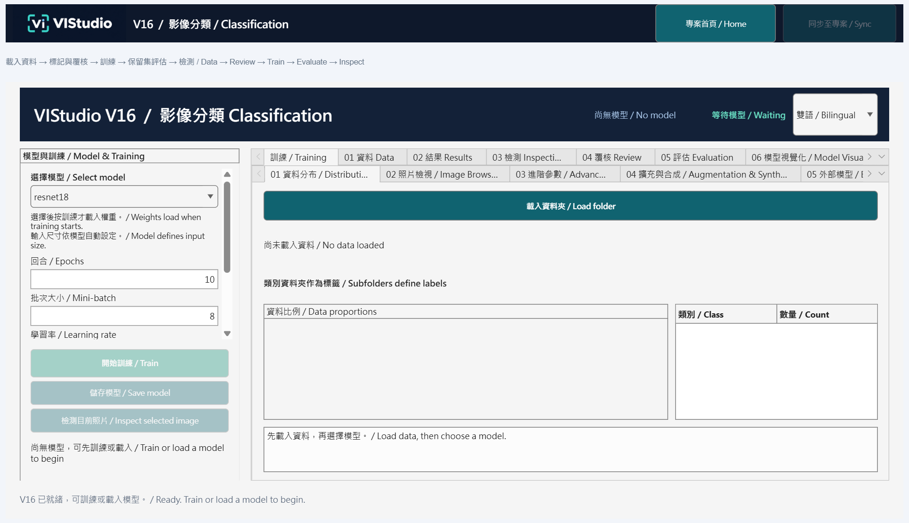</a>
      <p>選擇模型、檢視資料分布與照片，設定訓練及分類檢測。</p>
      <p>Select models, browse images and class distributions, then configure training and inspection.</p>
    </td>
<td width="50%" valign="top">
      <p><strong>02 · 物件偵測<br>Object detection</strong></p>
      <a href="docs/images/features/detection.png">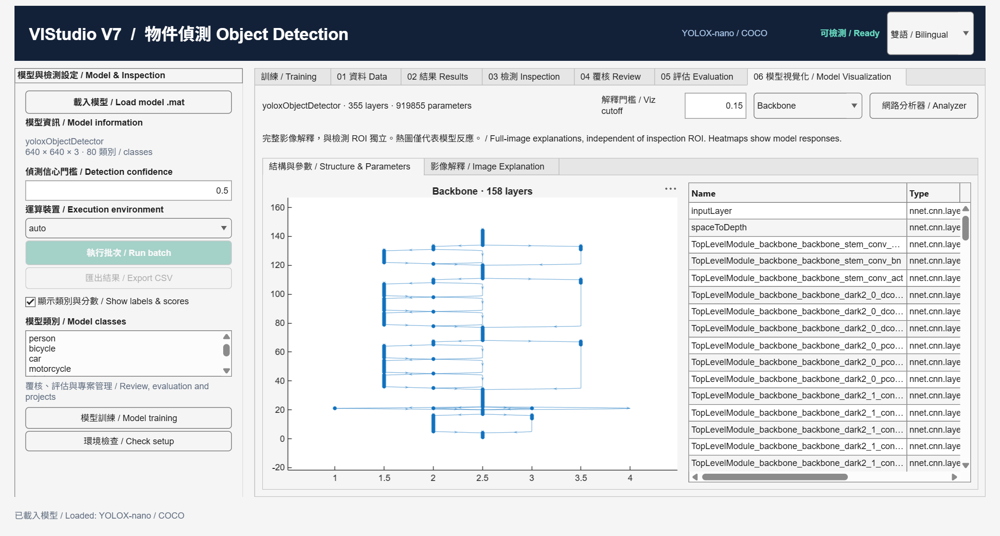</a>
      <p>定位、分類與計數；提供訓練設定、方框檢測與模型視覺化。</p>
      <p>Locate, classify and count objects with training controls, box results and model visualization.</p>
    </td>
</tr>
<tr>
<td width="50%" valign="top">
      <p><strong>03 · 異常偵測<br>Anomaly detection</strong></p>
      <a href="docs/images/features/anomaly.png">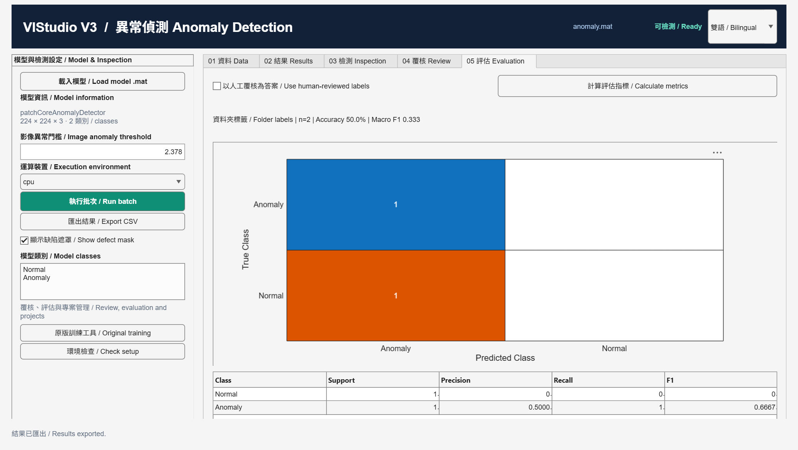</a>
      <p>設定異常門檻、覆核缺陷，查看混淆矩陣與評估指標。</p>
      <p>Configure anomaly thresholds, review defects and inspect confusion matrices and evaluation metrics.</p>
    </td>
<td width="50%" valign="top">
      <p><strong>04 · 語意分割<br>Semantic segmentation</strong></p>
      <a href="docs/images/features/semantic.png">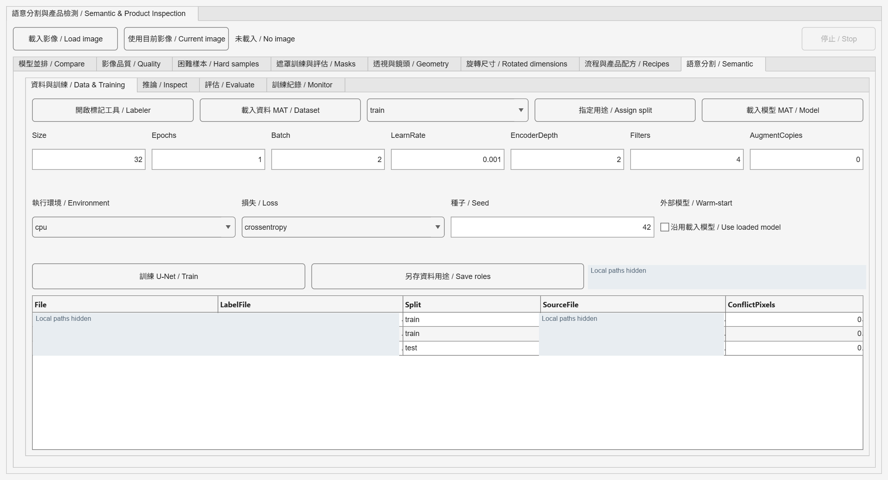</a>
      <p>建立像素類別遮罩，配置分割訓練並評估 IoU／Dice。</p>
      <p>Create pixel-class masks, configure segmentation training and evaluate IoU/Dice.</p>
    </td>
</tr>
<tr>
<td width="50%" valign="top">
      <p><strong>05 · 實例分割<br>Instance segmentation</strong></p>
      <a href="docs/images/features/instance.png">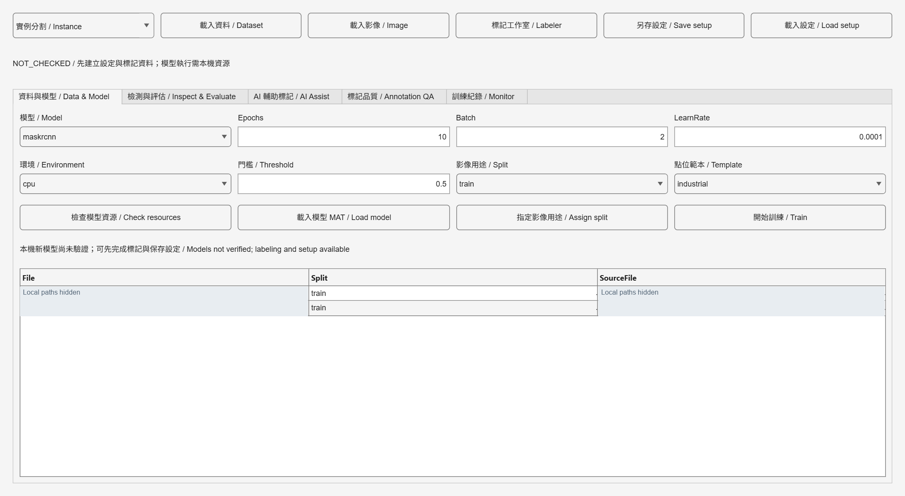</a>
      <p>分開管理物件遮罩與身分，配置模型並分析 mask AP。</p>
      <p>Manage individual object masks and identities, configure models and review mask AP.</p>
    </td>
<td width="50%" valign="top">
      <p><strong>06 · 關鍵點／肢節<br>Keypoints &amp; pose</strong></p>
      <a href="docs/images/features/keypoints.png">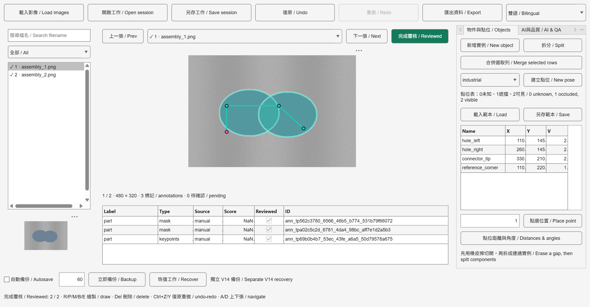</a>
      <p>編輯點位、骨架與可見性，使用範本並分析 PCK／定位誤差。</p>
      <p>Edit landmarks, skeletons and visibility with templates and PCK/localization error analysis.</p>
    </td>
</tr>
<tr>
<td width="50%" valign="top">
      <p><strong>07 · AI 輔助標記<br>AI-assisted annotation</strong></p>
      <a href="docs/images/features/ai-assist.png"></a>
      <p>以 SAM 點位或框提示產生候選，再由人工接受、修正或拒絕。</p>
      <p>Generate candidates from SAM point/box prompts, then accept, correct or reject them.</p>
    </td>
<td width="50%" valign="top">
      <p><strong>08 · 標記品質分析<br>Annotation quality</strong></p>
      <a href="docs/images/features/annotation-quality.png">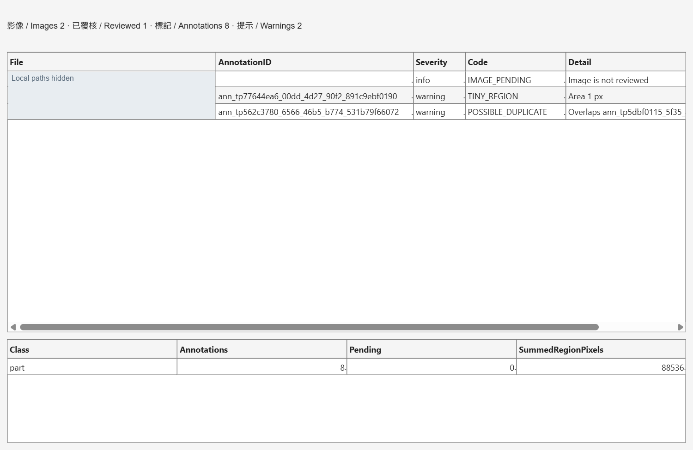</a>
      <p>檢查待覆核、微小區域與疑似重複標記，匯出品質報告。</p>
      <p>Review pending images, tiny regions and possible duplicates; export quality reports.</p>
    </td>
</tr>
<tr>
<td width="50%" valign="top">
      <p><strong>09 · 獨立量測<br>Measurement</strong></p>
      <a href="docs/images/features/measurement.png">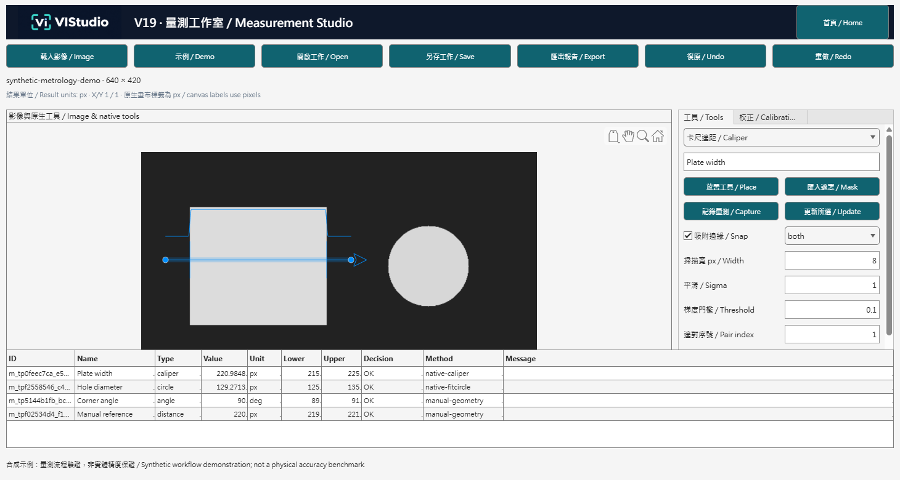</a>
      <p>量測距離、圓徑、角度與旋轉尺寸，搭配校正、公差及批次報告。</p>
      <p>Measure distances, diameters, angles and rotated dimensions with calibration, tolerances and batch reports.</p>
    </td>
<td width="50%" valign="top">
<p><strong>10 · 樣板／形狀匹配<br>Shape matching</strong></p>
<a href="docs/images/features/shape.png"></a>
<p>定位每個物件，搬移工具並重新量測，輸出逐物件摘要及工具結果。</p>
<p>Locate each object, transform its measurement tools and export individual remeasured results.</p>
</td>
</tr>
<tr><td colspan="2" valign="top">
<p><strong>11 · 影片 ROI 擷取 / Video ROI extraction</strong></p>
<a href="docs/images/features/video.png">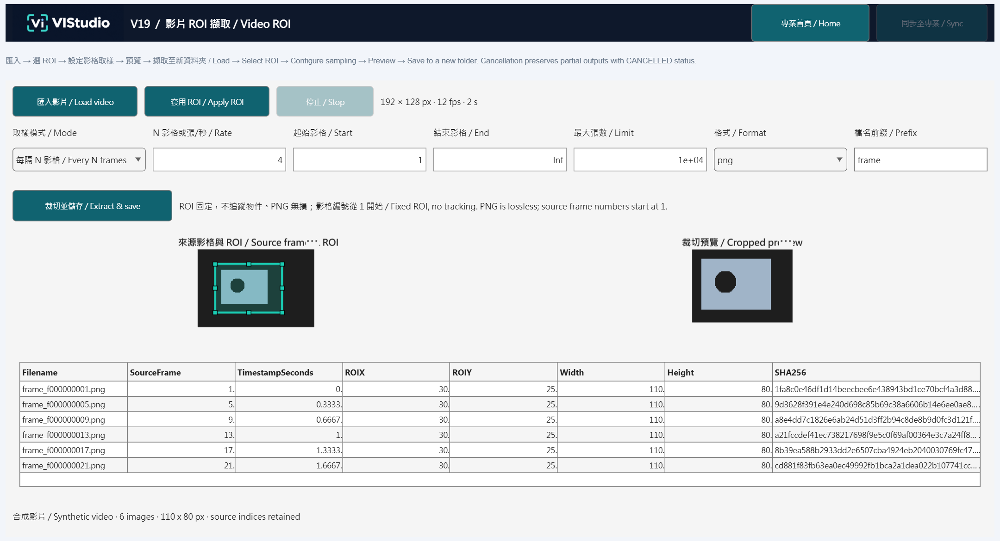</a>
<p>匯入影片、選定固定 ROI，再依影格間隔或每秒張數裁切儲存。支援起訖範圍、數量上限與停止，保留影格及時間清單。</p>
<p>Load a video, choose a fixed ROI and save crops by frame interval or images/second, with frame bounds, output limits, cancellation and provenance.</p>
</td></tr>
<tr>
<td width="50%" valign="top"><p><strong>12 · 影像拼接 / Image stitching</strong></p><a href="docs/images/features/stitch.png">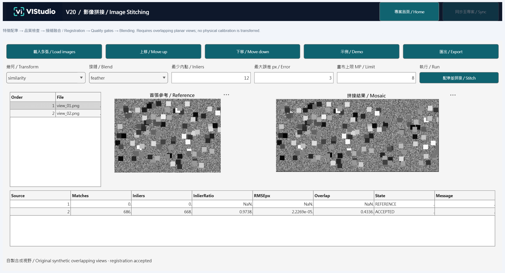</a><p>對重疊影像做配準、品質檢查及融合，保留有效區與座標變換。</p><p>Register and blend overlapping views with quality gates, valid coverage and coordinate transforms.</p></td>
<td width="50%" valign="top"><p><strong>13 · 影像缺陷合成 / Defect synthesis</strong></p><a href="docs/images/features/synthesis.png"></a><p>產生刮痕、斑點、污漬與貼片，匯出實際變更遮罩及可重現設定。</p><p>Generate procedural defects with exact changed-pixel masks and reproducible settings.</p></td>
</tr>
</table>

[樣板匹配評估與操作 / Shape matching assessment and guide](docs/SHAPE_MATCHING.md)

模型功能需對應 Toolbox、支援套件及權重；AI 候選需人工覆核。**104 項檢查涵蓋定位量測、影片擷取、形狀匹配與專案／標記回歸，未驗證所有大型模型或 GPU。**<br>
Model workflows require the relevant toolboxes, support packages and weights. AI candidates require human review. **The 104 checks cover pose-aware measurements, video extraction, native shape matching and measurement and project/annotation regressions, not all large models or GPU configurations.**

[各功能操作與資料格式 / Workspace workflows and data formats](docs/VISION_WORKFLOWS.md) · [量測手冊 / Measurement guide](docs/USER_GUIDE.md) · [影片擷取 / Video ROI](docs/VIDEO_EXTRACTION.md) · [範例庫評估 / Example-library assessment](docs/EXAMPLE_LIBRARY_ASSESSMENT.md)

---

<a id="guide"></a>

## English guide

VIStudio is a MATLAB **visual inspection workspace**. Start on the homepage to create or open a project, organize images, annotations, models and reports, and enter the workspace for your task.

The main workflow is **Data → Label → Train → Evaluate → Inspect**. The application brings together classification, object and anomaly detection, semantic/instance segmentation, keypoints, AI-assisted annotation and annotation quality analysis. V20 adds image stitching and procedural defect synthesis alongside pose-aware measurement and video ROI extraction, with paged workspaces and consistently versioned V20 frontends.

This is **MATLAB source release v20.0.0**, requiring MATLAB and the relevant toolboxes. Image change detection is planned for a later release.

## Start page and project hub

Running `start_VIStudio` opens the project homepage. On first use, choose New project in the sidebar; use Open project to continue existing work.

[View the start-page screenshot](#start-page)

| Homepage area | Purpose |
|---|---|
| Sidebar | Create, open, save and refresh projects; view the current task and help |
| Project | Review image/class counts, annotation review progress, pending candidates, model state and resource links |
| Five-stage navigation | Open Data, Label, Train, Evaluate or Inspect; Next recommends an action |
| Workspaces | Choose a vision, annotation or measurement tool |
| Model & Report | Inspect linked resources, report summaries and environment information |
| Recent | Reopen recent projects or locate moved project files |

Progress reflects **saved, linked artifacts**. Unsynchronized workspace changes are not automatically reflected on the homepage. A linked model does not prove verified training/inference, and an attached report does not establish acceptance.

## Requirements

Validated on **Windows with MATLAB R2026b**.

- Stitching: Image Processing Toolbox and Computer Vision Toolbox.
- Defect synthesis: Image Processing Toolbox; no AI weights.

- Measurement studio: MATLAB R2026b, Image Processing Toolbox, Visual Inspection Toolbox.
- Camera calibration and existing vision workflows: Computer Vision Toolbox as applicable.
- Deep learning workflows: Deep Learning Toolbox and task-specific support packages/weights. GPU is optional.
- Optional official COCO evaluation/polygon conversion: a supported Python environment with numpy and pycocotools. Measurement requires no Python.

Toolbox code, pretrained weights, Python binaries, private datasets, and MATLAB Compiler outputs are not bundled. API presence alone does not prove license availability or validated model performance.

<a id="install"></a>

## Install and launch

Download/unzip the entire release or clone the uploaded repository. In MATLAB, select the directory containing this README and run:

```matlab
start_VIStudio
```

For measurement only:

```matlab
if isfolder(fullfile(pwd, 'src')), addpath(fullfile(pwd, 'src')); end
app = VIStudioMeasurementAppV20;
```

Add `src` only, rather than using `genpath` across the repository. Unused historical launchers and implementations have been removed. Remaining versioned files in `src` are required V20 components, not separate old releases.

## Create your first project and follow the workflow

1. **Create a project:** enter its name, task and project folder, or open an existing project.
2. **Link resources:** select images, an annotation session, a dataset, model or evaluation report, then click Link. Use the same action to relocate moved resources.
3. **Annotate and review:** create truth in the annotation workspace. Accept, correct or reject AI candidates before reviewed dataset export.
4. **Configure and train:** select a model, parameters, augmentation and data splits. Install the resources required by the selected method.
5. **Evaluate independently:** use validation/test data for task metrics and error review. Calibrate anomaly thresholds using separate calibration data when required.
6. **Inspect and save:** run single-image or batch inspection and export results. Click Sync in a project workspace, then refresh the homepage.

A project stores resource links and settings; it does not automatically bundle every external image or model. See [Vision workflows](docs/VISION_WORKFLOWS.md) for task-specific data formats and procedures.

## Workspaces and capabilities

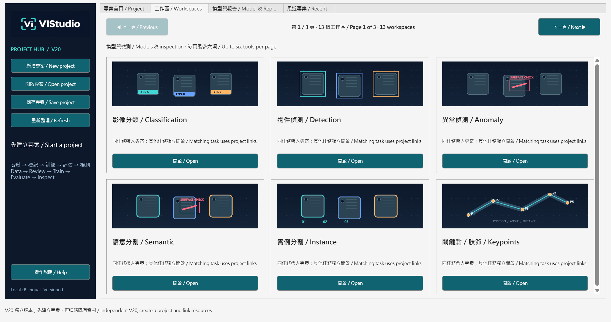


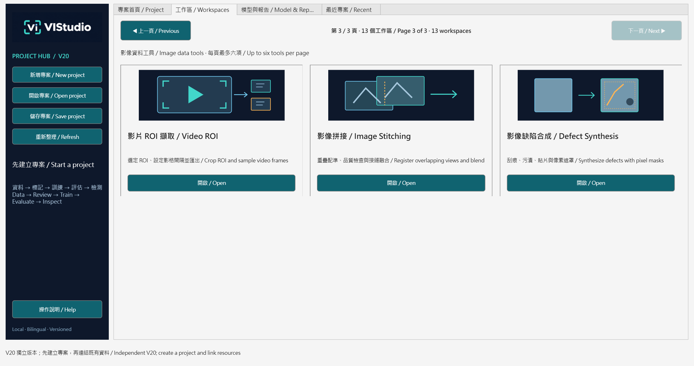

Each page contains up to six cards. Use Previous/Next to navigate; the card area scrolls in smaller windows.

| Workspace | Main purpose |
|---|---|
| Classification | Classify whole images, inspect distributions, train and run classification |
| Object detection | Locate, classify and count objects with box results |
| Anomaly detection | Inspect unusual regions, configure thresholds and review defect results |
| Semantic segmentation | Create pixel-class masks and train/evaluate segmentation |
| Instance segmentation | Keep separate object masks/identities and evaluate instance predictions |
| Keypoints & pose | Edit landmarks/skeletons and inspect PCK/error metrics |
| AI-assisted annotation | Generate candidates using available models, followed by human review |
| Annotation quality | Review duplicates, tiny regions, missing points and consistency |
| Independent measurement | Measure dimensions/angles, calibrate units and configure tolerances without a model |
| Shape matching | Localize each object, reposition tools and remeasure the search pixels with a template-bound recipe |
| Video ROI extraction | Crop a fixed ROI and save every N frames or images/second with a source manifest |
| Image stitching | Register adjacent overlapping views, validate quality and export blended mosaics/transforms |
| Defect synthesis | Procedural defects with changed-pixel masks, seeds and source grouping |

Models need their corresponding resources. Workspace availability is not proof that every model has been executed. Measurement can run directly without a model project.

## Help and documentation

The homepage Help button supports bilingual, Chinese and English views. It covers project creation, resource linking, workflow navigation, synchronization and missing-file handling.

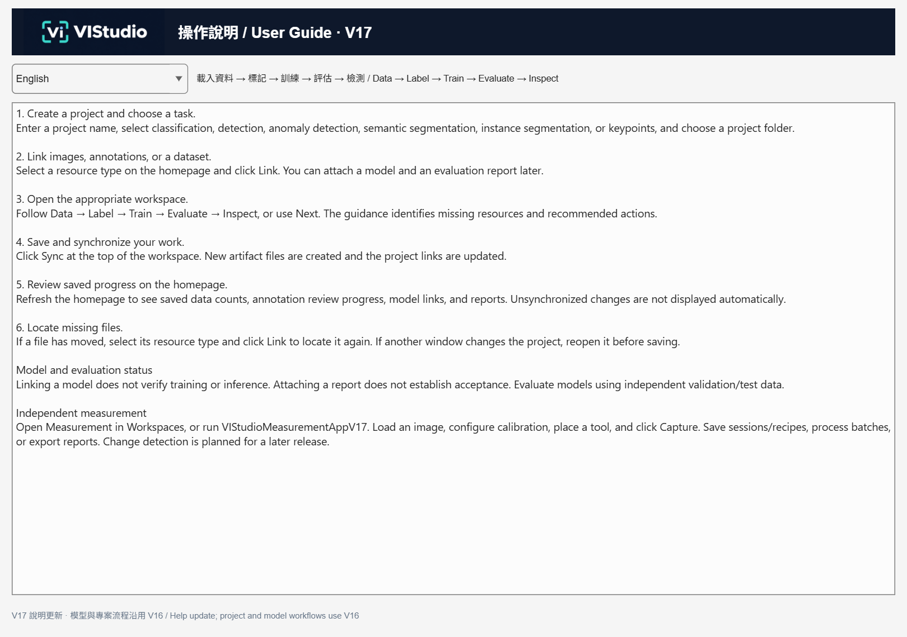

Detailed documentation: [Vision workflows](docs/VISION_WORKFLOWS.md) · [Measurement guide](docs/USER_GUIDE.md).

## Independent measurement workspace

Measurement is one of VIStudio's workspaces. Open Workspaces → Measurement, or run `VIStudioMeasurementAppV20` directly.


Tools include endpoint distance, native caliper edge-pair width, circle diameter, angle, point-to-line distance, mask area and rotated dimensions, with calibration, tolerances, Undo/Redo, sessions, recipes, batch processing and reports.

**Measurement sessions/recipes are saved independently and are not added to the model project's five-stage resource fields in this release.**

> Measurement screenshots use generated synthetic fixtures. They demonstrate workflows and do not certify physical measurement accuracy.

### Measurement walkthrough

1. Choose **Measurement** in the homepage Workspaces tab.
2. Click **Demo** to load the synthetic plate and circle.
3. Select a tool and click **Place**; place or drag its geometry in the viewer.
4. Set a name and optional limits, then **Capture**.
5. Select a row, adjust the tool, and **Update**; Undo restores the previous result.
6. **Export** creates a new report directory under the parent directory you choose.

The native canvas uses **pixel coordinates and annotations**. The result table's **Unit** column describes the stored measurement. Caliper always performs native edge-pair detection. Snap controls circle, angle and point-to-line behavior.

### Measurement calibration


Configure calibration **before capturing measurements**. Set X/Y mm per pixel, use a known-length line, or load an existing geometry MAT. Changing calibration clears current results; Undo restores them.

Anisotropic scales are supported for distances, angles, point-to-line distances, mask area and rotated dimensions. A physical circle diameter requires equal X/Y scales; otherwise it is not measured. Angles use `deg`; areas use `px^2` or `mm^2`. Lens correction alone does not establish a physical scale.

### Measurement decisions and failure handling

| State | Meaning |
|---|---|
| `MEASURED` | A value exists, but no tolerance was set; not an acceptance decision |
| `OK` | A finite result satisfies the configured inclusive limits |
| `NG` | A finite result violates a configured limit |
| `NOT_MEASURED` | No requested edge pair, degenerate geometry, invalid calibration or another measurement failure; value is NaN |
| Batch `REVIEW` / `ERROR` | At least one measurement failed, or an image could not use the recipe; later images continue |


### Measurement sessions, recipes and exports

- **Save/Open** stores the embedded original image, calibration, definitions and records. Loading checks the source hash and recomputes measurements instead of trusting edited stored values.
- **Recipe/Apply** reuses geometry and calibration on the same resolution and expected product pose. This release does not auto-align images.
- **Batch** applies the current recipe and retains per-image failures in its summary.
- **Export** writes CSV, MAT, source-aligned images, overlays and a reloadable session.

```text
report/
  measurements.csv
  measurements.mat
  measurement-image.png
  measurement-overlay.png
  measurement-session.mat
```


Masks must be binary grayscale and match the current measurement image dimensions. Rotated dimensions require a single connected object. Snapped point-to-line captures must be recaptured on a new image; use manual fixed geometry for batch point-to-line recipes.

### Measurement API

```matlab
addpath('src')
[image, definitions] = VIStudioMeasurementDemoV17;
data = VIStudioMeasurementV17;
data.loadImage(image, 'synthetic-demo');
s = definitions{1};
data.add(s.Kind, s.Geometry, s.Options);
disp(data.table())
recipeFile = [tempname '.mat'];
data.saveRecipe(recipeFile)
```

Output paths must be new files/directories. See the [user guide](docs/USER_GUIDE.md) for calibration, session and batch examples.

## Validation

```matlab
results = run_validation;
```

Run `verify_release` to check the shipped file inventory. The packaged tests cover native numerical measurements, failure states, calibration, portable sessions, transactional recipes, batch handling, visible-viewer image replacement, and existing project/annotation integration. Release evidence is in `validation/` and [VALIDATION](docs/VALIDATION.md).

Synthetic fixtures do not replace calibrated physical artifacts or repeatability/reproducibility studies. Full large-model/GPU execution, every mouse/dialog flow, long-running loads and other operating systems are outside this release's validation scope.

## Repository layout

```text
start_VIStudio.m           Launch V20
run_validation.m           Run packaged tests
src/                       Apps, versioned backends and local assets
examples/                  Model-free synthetic example
tests/                     Measurement/project/annotation tests
docs/                      Guide, screenshots and validation scope
validation/                Release verification summaries
RELEASE_MANIFEST.json       File inventory
SHA256SUMS                  File hashes
```

The release excludes local datasets, weights, sessions, `.git` history, backups and execution logs. `.gitignore` covers common generated artifacts. Do not add your own private data or model files when uploading the repository.

For issues, include MATLAB/toolbox versions, steps to reproduce, errors and a shareable minimal example. See [CONTRIBUTING](CONTRIBUTING.md).

The original README credits the initial build to **Fred Liu and Tim Yeh**. This distribution includes current documentation and required runtime components only. See [LICENSE_STATUS](LICENSE_STATUS.md) and [THIRD_PARTY_NOTICES](THIRD_PARTY_NOTICES.md). No new open-source license is selected by this packaging step.

## References

- [MathWorks measurement documentation](https://www.mathworks.com/help/visual-inspection/measurement-alignment.html)
- [Edge-snapping metrology app example](https://www.mathworks.com/help/visual-inspection/ug/create-an-app-to-measure-images-using-edge-snapping-metrology.html)


### 開發原稿與發布版 / Development and release layouts

開發原稿的 `.m` 檔位於根目錄；發布包放在 `src/`。兩者皆使用 `start_VIStudio` 啟動。V20 新增版本化介面，舊版實作與資料格式保持相容；README 與圖片已從發布版同步回開發原稿。

Development `.m` files are in the repository root; the source release uses `src/`. Both launch through `start_VIStudio`. V20 adds current versioned frontends while retaining legacy implementations and compatible data schemas. The release README and images have been synchronized back to the development source.


### V20 新功能 / New workflows

**定位後逐物件量測：**在樣板匹配開啟「設定量測工具」，於完全相同的裁切樣板記錄工具，再按「套用編輯器」。匹配後自動搬移工具並重新量測，匯出物件摘要、各工具結果與逐物件資料夾。[操作與支援範圍](docs/SHAPE_MATCHING.md)。

**Pose-aware measurement:** configure tools on the exact cropped template and click Use editor. Each match repositions tools and remeasures the search image. Export includes object summaries, tool results and per-object folders. [Guide and supported tools](docs/SHAPE_MATCHING.md).

**影片 ROI 擷取：**在工作區第三頁開啟，選定固定矩形 ROI，設定每隔 N 影格或每秒 N 張，再儲存到新資料夾。[取樣規則與輸出](docs/VIDEO_EXTRACTION.md)。

**Video ROI extraction:** on page three, select a fixed rectangle and sample by frame interval or images/second into a new folder. [Sampling rules and outputs](docs/VIDEO_EXTRACTION.md).

**範例庫暫緩，保留為未來更新考量之一。** 本次不新增範例庫介面或下載服務，既有評估供日後恢復規劃時參考。[優缺點與後續建議](docs/EXAMPLE_LIBRARY_ASSESSMENT.md)。

**The example library is deferred and retained for future consideration.** No library browser/downloader is added; the assessment remains for a later decision. [Benefits, costs and proposed scope](docs/EXAMPLE_LIBRARY_ASSESSMENT.md).


### 影像資料工具與更新方向 / Image data tools and future directions

第三頁集中影片擷取、影像拼接與缺陷合成；第二頁為標記與量測，第一頁為模型與檢測。每頁最多六項。

Page three groups video extraction, stitching and synthesis; page two contains annotation/metrology and page one model tasks. Pages contain at most six cards.

[影像拼接操作 / Stitching guide](docs/IMAGE_STITCHING.md) · [缺陷合成操作 / Synthesis guide](docs/DEFECT_SYNTHESIS.md) · [功能擴充分析與未來考量 / Feature roadmap](docs/FUTURE_FEATURES.md)

**範例庫維持暫緩。** 後續優先候選為合成資料覆核與訓練格式串接、來源群組切分、變化偵測與拼接品質檢視；未排定交付日期。

**The example library remains deferred.** Future candidates include reviewed synthetic-data adapters, grouped splits, change detection and stitch-quality inspection, without committed delivery dates.
