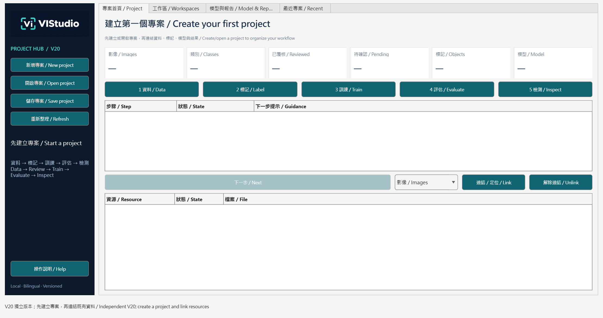
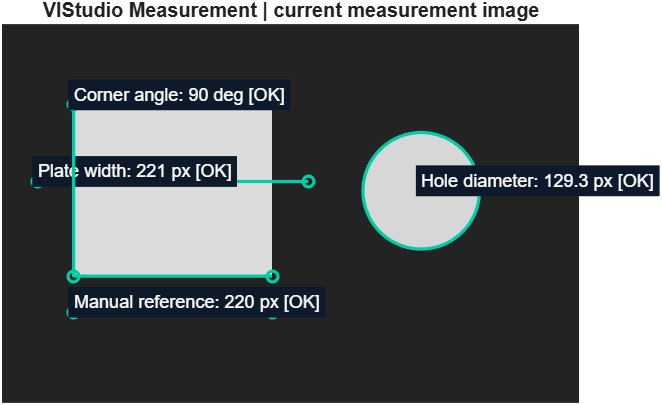

<p align="center"></p>

# VIStudio V17 — Visual Inspection Studio

[繁體中文](README.md#繁體中文) · [Vision workflows](docs/VISION_WORKFLOWS.md) · [Measurement guide](docs/USER_GUIDE.md) · [Release notes](CHANGELOG.md) · [Validation](docs/VALIDATION.md)

VIStudio is a MATLAB **visual inspection workspace**. Start on the homepage to create or open a project, organize images, annotations, models and reports, and enter the workspace for your task.

The main workflow is **Data → Label → Train → Evaluate → Inspect**. The application brings together classification, object and anomaly detection, semantic/instance segmentation, keypoints, AI-assisted annotation and annotation quality analysis. V17 also includes an independent measurement tool.

This is **MATLAB source release v17.0.0**, requiring MATLAB and the relevant toolboxes. Image change detection is planned for a later release.

## Start page and project hub

Running `start_VIStudio` opens the project homepage. On first use, choose New project in the sidebar; use Open project to continue existing work.



| Homepage area | Purpose |
|---|---|
| Sidebar | Create, open, save and refresh projects; view the current task and help |
| Project | Review image/class counts, annotation review progress, pending candidates, model state and resource links |
| Five-stage navigation | Open Data, Label, Train, Evaluate or Inspect; Next recommends an action |
| Workspaces | Choose a vision, annotation or measurement tool |
| Model & Report | Inspect linked resources, report summaries and environment information |
| Recent | Reopen recent projects or locate moved project files |

Progress reflects **saved, linked artifacts**. Unsynchronized workspace changes are not automatically reflected on the homepage. A linked model does not prove verified training/inference, and an attached report does not establish acceptance.

## Requirements

Validated on **Windows with MATLAB R2026b**.

- Measurement studio: MATLAB R2026b, Image Processing Toolbox, Visual Inspection Toolbox.
- Camera calibration and existing vision workflows: Computer Vision Toolbox as applicable.
- Deep learning workflows: Deep Learning Toolbox and task-specific support packages/weights. GPU is optional.
- Optional official COCO evaluation/polygon conversion: a supported Python environment with numpy and pycocotools. Measurement requires no Python.

Toolbox code, pretrained weights, Python binaries, private datasets, and MATLAB Compiler outputs are not bundled. API presence alone does not prove license availability or validated model performance.

## Install and launch

Download/unzip the entire release or clone the uploaded repository. In MATLAB, select the directory containing this README and run:

```matlab
start_VIStudio
```

For measurement only:

```matlab
addpath(fullfile(pwd, 'src'))
app = VIStudioMeasurementAppV17;
```

Add `src` only, rather than using `genpath` across the repository. Unused historical launchers and implementations have been removed. Remaining versioned files in `src` are required V17 components, not separate old releases.

## Create your first project and follow the workflow

1. **Create a project:** enter its name, task and project folder, or open an existing project.
2. **Link resources:** select images, an annotation session, a dataset, model or evaluation report, then click Link. Use the same action to relocate moved resources.
3. **Annotate and review:** create truth in the annotation workspace. Accept, correct or reject AI candidates before reviewed dataset export.
4. **Configure and train:** select a model, parameters, augmentation and data splits. Install the resources required by the selected method.
5. **Evaluate independently:** use validation/test data for task metrics and error review. Calibrate anomaly thresholds using separate calibration data when required.
6. **Inspect and save:** run single-image or batch inspection and export results. Click Sync in a project workspace, then refresh the homepage.

A project stores resource links and settings; it does not automatically bundle every external image or model. See [Vision workflows](docs/VISION_WORKFLOWS.md) for task-specific data formats and procedures.

## Workspaces and capabilities


| Workspace | Main purpose |
|---|---|
| Classification | Classify whole images, inspect distributions, train and run classification |
| Object detection | Locate, classify and count objects with box results |
| Anomaly detection | Inspect unusual regions, configure thresholds and review defect results |
| Semantic segmentation | Create pixel-class masks and train/evaluate segmentation |
| Instance segmentation | Keep separate object masks/identities and evaluate instance predictions |
| Keypoints & pose | Edit landmarks/skeletons and inspect PCK/error metrics |
| AI-assisted annotation | Generate candidates using available models, followed by human review |
| Annotation quality | Review duplicates, tiny regions, missing points and consistency |
| Independent measurement | Measure dimensions/angles, calibrate units and configure tolerances without a model |

Models need their corresponding resources. Workspace availability is not proof that every model has been executed. Measurement can run directly without a model project.

## Help and documentation

The homepage Help button supports bilingual, Chinese and English views. It covers project creation, resource linking, workflow navigation, synchronization and missing-file handling.


Detailed documentation: [Vision workflows](docs/VISION_WORKFLOWS.md) · [Measurement guide](docs/USER_GUIDE.md).

## Independent measurement workspace

Measurement is one of VIStudio's workspaces. Open Workspaces → Measurement, or run `VIStudioMeasurementAppV17` directly.


Tools include endpoint distance, native caliper edge-pair width, circle diameter, angle, point-to-line distance, mask area and rotated dimensions, with calibration, tolerances, Undo/Redo, sessions, recipes, batch processing and reports.

**Measurement sessions/recipes are saved independently and are not added to the model project's five-stage resource fields in this release.**

> Measurement screenshots use generated synthetic fixtures. They demonstrate workflows and do not certify physical measurement accuracy.

### Measurement walkthrough

1. Choose **Measurement** in the homepage Workspaces tab.
2. Click **Demo** to load the synthetic plate and circle.
3. Select a tool and click **Place**; place or drag its geometry in the viewer.
4. Set a name and optional limits, then **Capture**.
5. Select a row, adjust the tool, and **Update**; Undo restores the previous result.
6. **Export** creates a new report directory under the parent directory you choose.

The native canvas uses **pixel coordinates and annotations**. The result table's **Unit** column describes the stored measurement. Caliper always performs native edge-pair detection. Snap controls circle, angle and point-to-line behavior.

### Measurement calibration


Configure calibration **before capturing measurements**. Set X/Y mm per pixel, use a known-length line, or load an existing geometry MAT. Changing calibration clears current results; Undo restores them.

Anisotropic scales are supported for distances, angles, point-to-line distances, mask area and rotated dimensions. A physical circle diameter requires equal X/Y scales; otherwise it is not measured. Angles use `deg`; areas use `px^2` or `mm^2`. Lens correction alone does not establish a physical scale.

### Measurement decisions and failure handling

| State | Meaning |
|---|---|
| `MEASURED` | A value exists, but no tolerance was set; not an acceptance decision |
| `OK` | A finite result satisfies the configured inclusive limits |
| `NG` | A finite result violates a configured limit |
| `NOT_MEASURED` | No requested edge pair, degenerate geometry, invalid calibration or another measurement failure; value is NaN |
| Batch `REVIEW` / `ERROR` | At least one measurement failed, or an image could not use the recipe; later images continue |


### Measurement sessions, recipes and exports

- **Save/Open** stores the embedded original image, calibration, definitions and records. Loading checks the source hash and recomputes measurements instead of trusting edited stored values.
- **Recipe/Apply** reuses geometry and calibration on the same resolution and expected product pose. This release does not auto-align images.
- **Batch** applies the current recipe and retains per-image failures in its summary.
- **Export** writes CSV, MAT, source-aligned images, overlays and a reloadable session.

```text
report/
  measurements.csv
  measurements.mat
  measurement-image.png
  measurement-overlay.png
  measurement-session.mat
```



Masks must be binary grayscale and match the current measurement image dimensions. Rotated dimensions require a single connected object. Snapped point-to-line captures must be recaptured on a new image; use manual fixed geometry for batch point-to-line recipes.

### Measurement API

```matlab
addpath('src')
[image, definitions] = VIStudioMeasurementDemoV17;
data = VIStudioMeasurementV17;
data.loadImage(image, 'synthetic-demo');
s = definitions{1};
data.add(s.Kind, s.Geometry, s.Options);
disp(data.table())
recipeFile = [tempname '.mat'];
data.saveRecipe(recipeFile)
```

Output paths must be new files/directories. See the [user guide](docs/USER_GUIDE.md) for calibration, session and batch examples.

## Validation

```matlab
results = run_validation;
```

Run `verify_release` to check the shipped file inventory. The packaged tests cover native numerical measurements, failure states, calibration, portable sessions, transactional recipes, batch handling, visible-viewer image replacement, and existing project/annotation integration. Release evidence is in `validation/` and [VALIDATION](docs/VALIDATION.md).

Synthetic fixtures do not replace calibrated physical artifacts or repeatability/reproducibility studies. Full large-model/GPU execution, every mouse/dialog flow, long-running loads and other operating systems are outside this release's validation scope.

## Repository layout

```text
start_VIStudio.m           Launch V17
run_validation.m           Run packaged tests
src/                       Apps, versioned backends and local assets
examples/                  Model-free synthetic example
tests/                     Measurement/project/annotation tests
docs/                      Guide, screenshots and validation scope
validation/                Release verification summaries
RELEASE_MANIFEST.json       File inventory
SHA256SUMS                  File hashes
```

The release excludes local datasets, weights, sessions, `.git` history, backups and execution logs. `.gitignore` covers common generated artifacts. Do not add your own private data or model files when uploading the repository.

For issues, include MATLAB/toolbox versions, steps to reproduce, errors and a shareable minimal example. See [CONTRIBUTING](CONTRIBUTING.md).

The original README credits the initial build to **Fred Liu and Tim Yeh**. This distribution includes current documentation and required runtime components only. See [LICENSE_STATUS](LICENSE_STATUS.md) and [THIRD_PARTY_NOTICES](THIRD_PARTY_NOTICES.md). No new open-source license is selected by this packaging step.

## References

- [MathWorks measurement documentation](https://www.mathworks.com/help/visual-inspection/measurement-alignment.html)
- [Edge-snapping metrology app example](https://www.mathworks.com/help/visual-inspection/ug/create-an-app-to-measure-images-using-edge-snapping-metrology.html)
