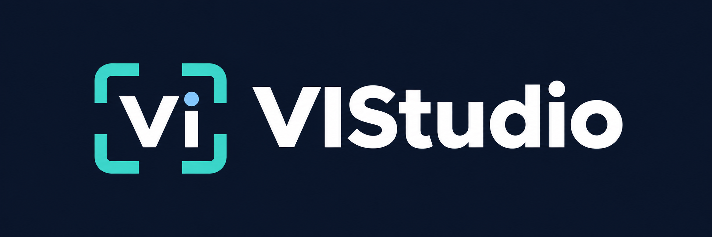
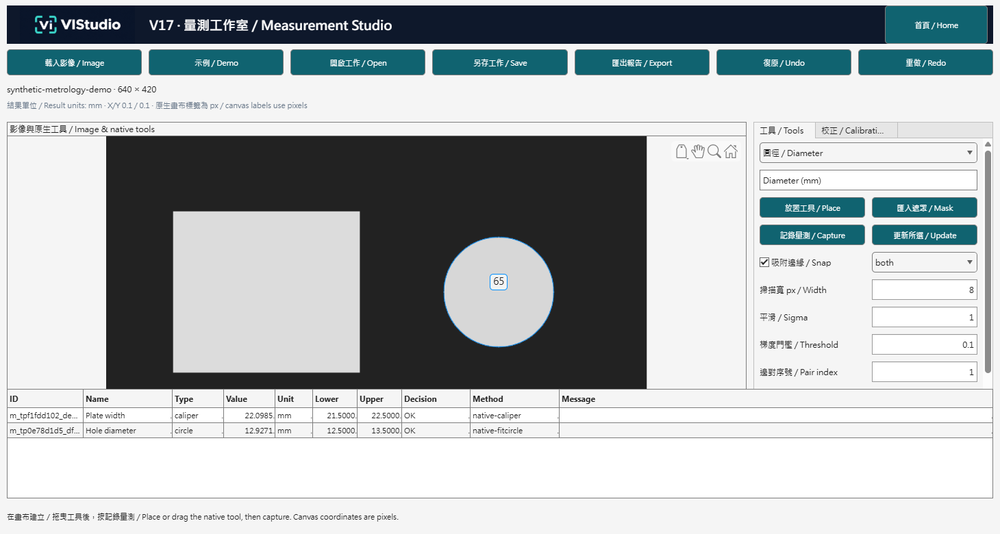
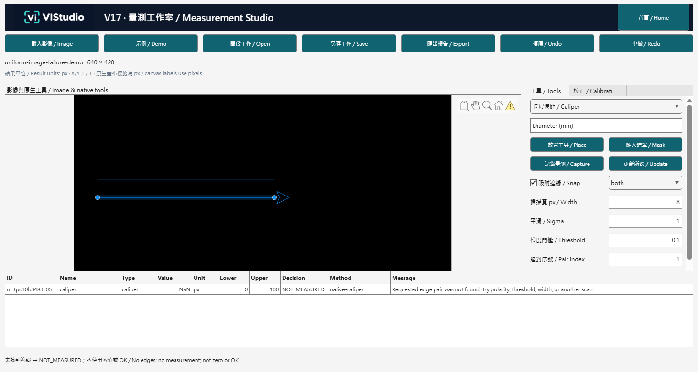

<p align="center"></p>

# VIStudio V17 — Visual Inspection and Independent Measurement

[繁體中文](README.md) · [Measurement guide](docs/USER_GUIDE.md) · [Vision workflows](docs/VISION_WORKFLOWS.md) · [Release notes](CHANGELOG.md) · [Validation scope](docs/VALIDATION.md)

VIStudio is a MATLAB desktop application for visual inspection. V17 adds a **model-free measurement studio** with native caliper edge detection, circle fitting, geometric measurements, calibration, tolerances, portable sessions, recipes, and batch exports.

This is **source release v17.0.0**. MATLAB and the relevant toolboxes are required. It is not a compiled standalone application. **Image change detection is deferred to a later release.**


The screenshots use original synthetic fixtures. They demonstrate workflows and do not certify physical measurement accuracy.

## Features

| Area | Included |
|---|---|
| Measurement | Endpoint distance, native caliper edge-pair width, circle diameter, angle, point-to-line distance |
| Binary masks | Area and minimum rotated rectangle long/short dimensions for one connected object |
| Calibration | Pixels, mm, known-length reference, independent X/Y scales, existing lens/perspective MAT profiles |
| Decisions | Inclusive lower/upper limits; `MEASURED` without limits; NaN and `NOT_MEASURED` on failure |
| Editing | Native interactive tools, capture/update, delete, Undo/Redo |
| Persistence | Embedded-image sessions, deterministic recomputation, reusable recipes |
| Batch | Fixed-ROI recipes, per-image failure isolation, image reports and summary |
| Existing workflows | Project hub, classification, detection, anomaly, semantic/instance segmentation, keypoints and annotation |

## Requirements

Validated on **Windows with MATLAB R2026b**.

- Measurement studio: MATLAB R2026b, Image Processing Toolbox, Visual Inspection Toolbox.
- Camera calibration and existing vision workflows: Computer Vision Toolbox as applicable.
- Deep learning workflows: Deep Learning Toolbox and task-specific support packages/weights. GPU is optional.
- Optional official COCO evaluation/polygon conversion: a supported Python environment with numpy and pycocotools. Measurement requires no Python.

Toolbox code, pretrained weights, Python binaries, private datasets, and MATLAB Compiler outputs are not bundled. API presence alone does not prove license availability or validated model performance.

## Install and launch

Download/unzip the entire release or clone the uploaded repository. In MATLAB, select the directory containing this README and run:

```matlab
start_VIStudio
```

For measurement only:

```matlab
addpath(fullfile(pwd, 'src'))
app = VIStudioMeasurementAppV17;
```

Add `src` only, rather than using `genpath` across the repository. Unused historical launchers and implementations have been removed. Remaining versioned files in `src` are required V17 components, not separate old releases.

## Quick walkthrough

1. Choose **Measurement** in the homepage Workspaces tab.
2. Click **Demo** to load the synthetic plate and circle.
3. Select a tool and click **Place**; place or drag its geometry in the viewer.
4. Set a name and optional limits, then **Capture**.
5. Select a row, adjust the tool, and **Update**; Undo restores the previous result.
6. **Export** creates a new report directory under the parent directory you choose.

The native canvas uses **pixel coordinates and annotations**. The result table's **Unit** column describes the stored measurement. Caliper always performs native edge-pair detection. Snap controls circle, angle and point-to-line behavior.

## Calibration



Configure calibration **before capturing measurements**. Set X/Y mm per pixel, use a known-length line, or load an existing geometry MAT. Changing calibration clears current results; Undo restores them.

Anisotropic scales are supported for distances, angles, point-to-line distances, mask area and rotated dimensions. A physical circle diameter requires equal X/Y scales; otherwise it is not measured. Angles use `deg`; areas use `px^2` or `mm^2`. Lens correction alone does not establish a physical scale.

## Decisions and failure handling

| State | Meaning |
|---|---|
| `MEASURED` | A value exists, but no tolerance was set; not an acceptance decision |
| `OK` | A finite result satisfies the configured inclusive limits |
| `NG` | A finite result violates a configured limit |
| `NOT_MEASURED` | No requested edge pair, degenerate geometry, invalid calibration or another measurement failure; value is NaN |
| Batch `REVIEW` / `ERROR` | At least one measurement failed, or an image could not use the recipe; later images continue |



## Sessions, recipes and exports

- **Save/Open** stores the embedded original image, calibration, definitions and records. Loading checks the source hash and recomputes measurements instead of trusting edited stored values.
- **Recipe/Apply** reuses geometry and calibration on the same resolution and expected product pose. This release does not auto-align images.
- **Batch** applies the current recipe and retains per-image failures in its summary.
- **Export** writes CSV, MAT, source-aligned images, overlays and a reloadable session.

```text
report/
  measurements.csv
  measurements.mat
  measurement-image.png
  measurement-overlay.png
  measurement-session.mat
```


Masks must be binary grayscale and match the current measurement image dimensions. Rotated dimensions require a single connected object. Snapped point-to-line captures must be recaptured on a new image; use manual fixed geometry for batch point-to-line recipes.

## Programmatic use

```matlab
addpath('src')
[image, definitions] = VIStudioMeasurementDemoV17;
data = VIStudioMeasurementV17;
data.loadImage(image, 'synthetic-demo');
s = definitions{1};
data.add(s.Kind, s.Geometry, s.Options);
disp(data.table())
recipeFile = [tempname '.mat'];
data.saveRecipe(recipeFile)
```

Output paths must be new files/directories. See the [user guide](docs/USER_GUIDE.md) for calibration, session and batch examples.

## Project hub and help


Measurement can run without a model project. Existing model projects retain the V16 project schema and synchronization behavior. **Measurement sessions/recipes are saved independently and are not added to the V16 five-stage project resource fields in this release.**


## Validation

```matlab
results = run_validation;
```

Run `verify_release` to check the shipped file inventory. The packaged tests cover native numerical measurements, failure states, calibration, portable sessions, transactional recipes, batch handling, visible-viewer image replacement, and existing project/annotation integration. Release evidence is in `validation/` and [VALIDATION](docs/VALIDATION.md).

Synthetic fixtures do not replace calibrated physical artifacts or repeatability/reproducibility studies. Full large-model/GPU execution, every mouse/dialog flow, long-running loads and other operating systems are outside this release's validation scope.

## Repository layout

```text
start_VIStudio.m           Launch V17
run_validation.m           Run packaged tests
src/                       Apps, versioned backends and local assets
examples/                  Model-free synthetic example
tests/                     Measurement/project/annotation tests
docs/                      Guide, screenshots and validation scope
validation/                Release verification summaries
RELEASE_MANIFEST.json       File inventory
SHA256SUMS                  File hashes
```

The release excludes local datasets, weights, sessions, `.git` history, backups and execution logs. `.gitignore` covers common generated artifacts. Do not add your own private data or model files when uploading the repository.

For issues, include MATLAB/toolbox versions, steps to reproduce, errors and a shareable minimal example. See [CONTRIBUTING](CONTRIBUTING.md).

The original README credits the initial build to **Fred Liu and Tim Yeh**. This distribution includes current documentation and required runtime components only. See [LICENSE_STATUS](LICENSE_STATUS.md) and [THIRD_PARTY_NOTICES](THIRD_PARTY_NOTICES.md). No new open-source license is selected by this packaging step.

## References

- [MathWorks measurement documentation](https://www.mathworks.com/help/visual-inspection/measurement-alignment.html)
- [Edge-snapping metrology app example](https://www.mathworks.com/help/visual-inspection/ug/create-an-app-to-measure-images-using-edge-snapping-metrology.html)
