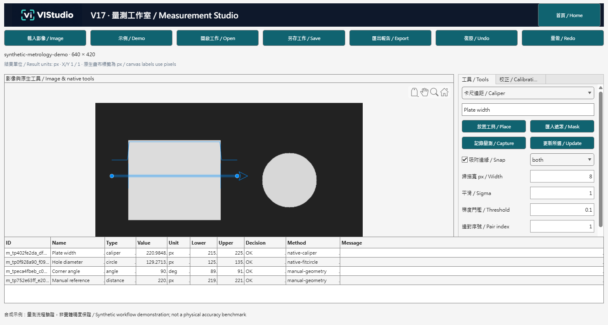
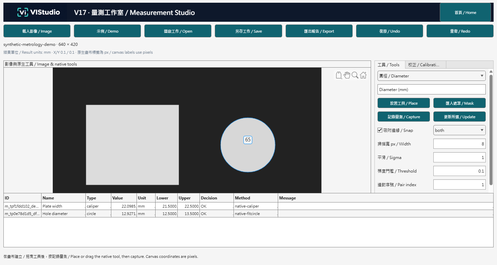
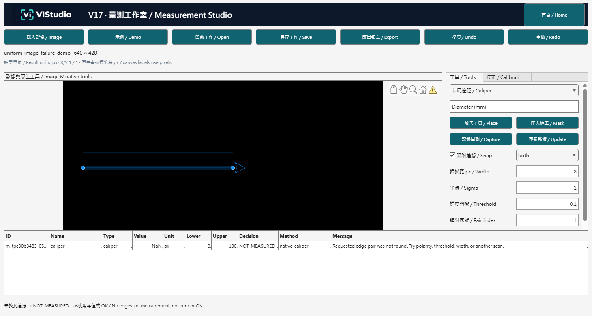
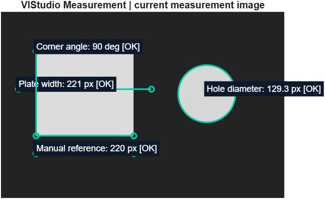
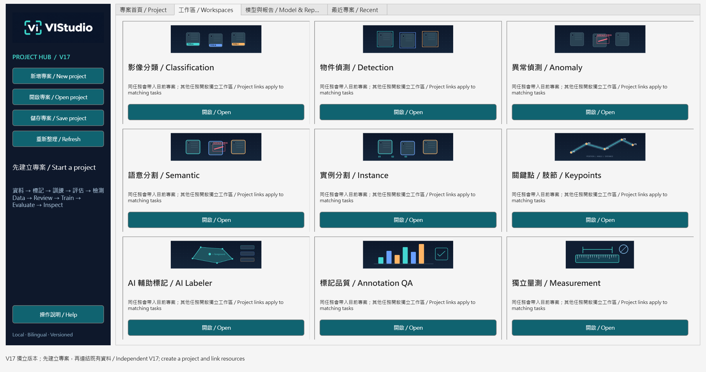
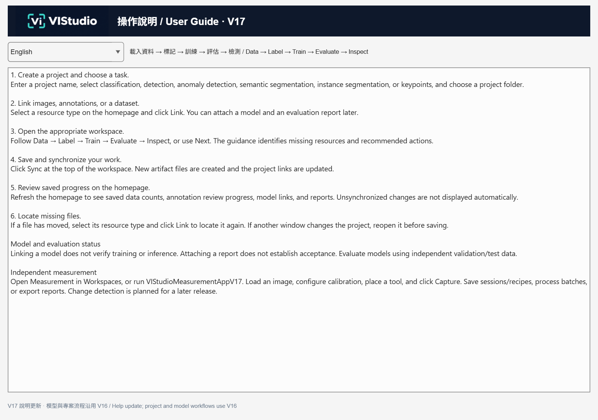

<p align="center"></p>

# VIStudio V17 — 視覺檢測與獨立量測工作室

[English README](README.en.md) · [量測操作手冊](docs/USER_GUIDE.md) · [視覺工作流程](docs/VISION_WORKFLOWS.md) · [發布說明](CHANGELOG.md) · [驗證範圍](docs/VALIDATION.md)

VIStudio 是使用 MATLAB 建立的視覺檢測桌面工具。V17 加入**可獨立使用的量測工作室**，將原生邊緣卡尺、圓擬合與幾何量測整合到同一介面，支援校正、公差判定、工作階段保存及批次報告。

這是 **MATLAB 原始碼發布包 v17.0.0**，需要 MATLAB 與對應 Toolbox；不是已編譯的獨立執行檔。**Change Detection 留待下一版，本版未包含。**



> 畫面使用程式生成的合成示例，展示操作與數值流程，並非實體樣件的精度認證。

## 主要功能

| 功能 | 本版內容 |
|---|---|
| 獨立量測 | 距離、原生卡尺邊對、圓徑、角度、點到線距離 |
| 遮罩量測 | 面積、單一物件最小旋轉外接框長／短邊 |
| 校正與單位 | px、mm、參考線段比例、X/Y 比例、既有透視／鏡頭校正 MAT |
| 判定 | 上／下限；無公差時只記錄量測；找不到邊時輸出 `NOT_MEASURED` |
| 編輯與保存 | 拖曳原生工具、記錄／更新、刪除、Undo/Redo、獨立工作階段與配方 |
| 批次 | 固定 ROI 配方套用、逐張失敗隔離、每張報告與批次摘要 |
| 專案工作台 | 延續專案資源連結、覆核進度及 Data → Label → Train → Evaluate → Inspect 引導 |
| 其他視覺任務 | 延續分類、物件／異常偵測、語意／實例分割、關鍵點與標記工具；各模型另需資源 |

## 環境需求

本次在 **Windows、MATLAB R2026b** 驗證。

| 用途 | 需求 |
|---|---|
| 新量測工作室 | MATLAB R2026b、Image Processing Toolbox、Visual Inspection Toolbox |
| 鏡頭校正／既有視覺流程 | Computer Vision Toolbox；其他功能依使用的工具另有需求 |
| 深度學習訓練／推論 | Deep Learning Toolbox、對應模型支援套件與權重；GPU 為選用 |
| COCO 官方評估／多邊形交換 | 選用：MATLAB 支援的 Python、numpy、pycocotools；量測不需 Python |

只找到 API 不代表已驗證授權取用、實體量測精度或所有模型。此發布包不附 MathWorks Toolbox、預訓練權重、Python 二進位套件及本機私人資料集。

## 安裝與啟動

1. 將此資料夾上傳至 GitHub，或下載並解壓縮整份發布包。
2. 在 MATLAB 將目前資料夾切換到含本 README 的目錄。
3. 執行：

```matlab
start_VIStudio
```

直接開量測工具：

```matlab
addpath(fullfile(pwd, 'src'))
app = VIStudioMeasurementAppV17;
```

不用 `genpath` 加入整個專案；`start_VIStudio` 只加入 `src`，避免測試與範例檔干擾搜尋路徑。`src` 已移除未使用的歷史入口與實作。保留下來的版本化檔案是 V17 仍需使用的後端，不是舊版發布包。

## 三分鐘量測示範

1. 在首頁「工作區」選 **獨立量測 / Measurement**。
2. 按 **Demo**，載入本專案合成的板件與圓形。
3. 選工具並按 **Place**，在畫布建立或拖曳量測位置。
4. 設定名稱及公差，按 **Capture** 建立一筆量測。
5. 選取結果列後拖曳工具，再按 **Update** 更新該筆；可 Undo。
6. 按 **Export**，選父資料夾，系統在新資料夾匯出報告。

原生畫布的座標／標籤以 **px** 為準；結果表的 **Unit** 欄才是保存的量測單位。卡尺固定執行邊對偵測；Snap 開關作用於圓、角度與點到線。



**毫米流程：先校正，再建立量測。** 比例校正可輸入 X/Y mm/px，或用已知長度線段建立等向比例。校正變更會清空目前量測，可用 Undo 還原。圓徑 mm 要求 X/Y 比例相同；不相同時會記錄未能量測，避免把橢圓當成圓。角度單位始終為 `deg`，面積為 `px^2` 或 `mm^2`。

## 結果判讀

| 狀態 | 意義 |
|---|---|
| `MEASURED` | 有量測值，但沒有設定公差；不表示合格 |
| `OK` | 有量測值，且符合已設定的界限，含邊界 |
| `NG` | 有量測值，且超過已設定的界限 |
| `NOT_MEASURED` | 未找到所選邊對、幾何退化、校正不符或其他量測失敗；值為 NaN，附原因 |
| 批次 `REVIEW` / `ERROR` | 含未能量測項目，或該張影像無法依配方處理；其他影像繼續 |



## 工作階段、配方與匯出

- **Save / Open**：保存內嵌原始影像、校正、量測定義與紀錄。載入時重新計算結果並核對影像雜湊。
- **Recipe / Apply**：保存量測定義與校正，套用到相同解析度、相同視角／定位的影像；本版不提供自動對齊。
- **Batch**：選多張影像，依目前配方量測。影像尺寸不符與其他錯誤會保留在批次摘要。
- **Export**：匯出 `measurements.csv`、`measurements.mat`、量測影像、疊圖與可重新開啟的工作階段。

```text
report/
  measurements.csv
  measurements.mat
  measurement-image.png
  measurement-overlay.png
  measurement-session.mat
```



遮罩必須與目前量測影像同尺寸，使用灰階二值圖；旋轉尺寸只接受一個連通物件。原生吸附的點到線量測須在新影像重新擷取；批次固定幾何請使用未吸附的點到線配方。

## 程式介面

```matlab
addpath('src')
[image, definitions] = VIStudioMeasurementDemoV17;
data = VIStudioMeasurementV17;
data.loadImage(image, 'synthetic-demo');
s = definitions{1};
data.add(s.Kind, s.Geometry, s.Options); % 原生卡尺
disp(data.table())
recipeFile = [tempname '.mat'];
data.saveRecipe(recipeFile)
```

輸出路徑必須是新檔／新資料夾；不會覆寫既有工作或報告。完整 API、校正與批次範例見 [操作手冊](docs/USER_GUIDE.md)。

## 專案工作台與中英說明



首頁新增獨立量測入口；量測不要求先建立模型專案。既有模型專案仍沿用 V16 資料格式與同步流程。**本版量測的工作階段／配方獨立保存，尚未加入 V16 專案五步驟的資源欄位。**



## 驗證與限制

```matlab
results = run_validation;
```

發布驗證結果與明確範圍放在 [VALIDATION](docs/VALIDATION.md) 與 `validation/`。可先執行 `verify_release` 比對發布檔案。測試包括原生量測數值、失敗狀態、校正、工作階段、配方、批次、可見視窗換圖，以及既有專案／標記整合。合成測試不替代實體標準件、重複性與再現性驗證。

本版未宣稱驗證所有大型模型、GPU 訓練、所有滑鼠／原生對話框流程、長時間負載、其他作業系統，亦未提供 Change Detection 或 compiled standalone executable。

## 專案結構

```text
start_VIStudio.m          啟動 V17
run_validation.m          執行隨包測試
src/                      應用程式、穩定後端與本機圖像資產
examples/                 不需要模型的合成量測範例
tests/                    本版量測與既有工作區整合測試
docs/                     操作手冊、截圖、驗證範圍
validation/               發布時的驗證摘要
RELEASE_MANIFEST.json      發布檔案清單
SHA256SUMS                 檔案雜湊
```

不要上傳自己的影像、權重、工作階段或執行產物；本包的 `.gitignore` 已列出常用產物路徑。原始碼發布包沒有私人資料集、權重、`.git` 歷史、備份或本機執行日誌。

## 回報問題與後續規劃

請在 GitHub Issues 提供 MATLAB 版本、Toolbox、操作步驟、錯誤訊息及可分享的最小範例。請參考 [CONTRIBUTING](CONTRIBUTING.md)。

下一版優先評估基準圖配準與 Change Detection，之後再接「定位 → 比對 → 量測 → OK/NG」產品配方。

初始專案 README 記錄的建置者為 **Fred Liu 與 Tim Yeh**。發布包僅附最新版文件與目前需要的元件。授權狀態及第三方項目見 [LICENSE_STATUS](LICENSE_STATUS.md) 與 [THIRD_PARTY_NOTICES](THIRD_PARTY_NOTICES.md)。

## 官方參考

- [Visual Inspection Toolbox：量測](https://www.mathworks.com/help/visual-inspection/measurement-alignment.html)
- [建立邊緣吸附量測 App](https://www.mathworks.com/help/visual-inspection/ug/create-an-app-to-measure-images-using-edge-snapping-metrology.html)
