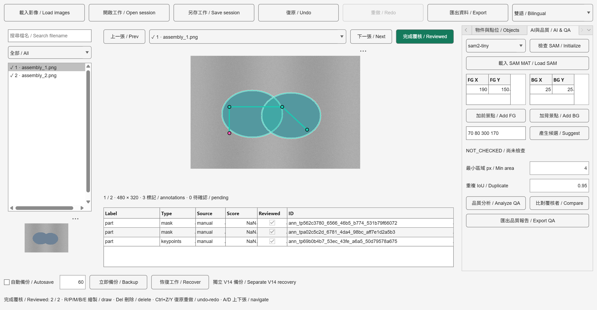
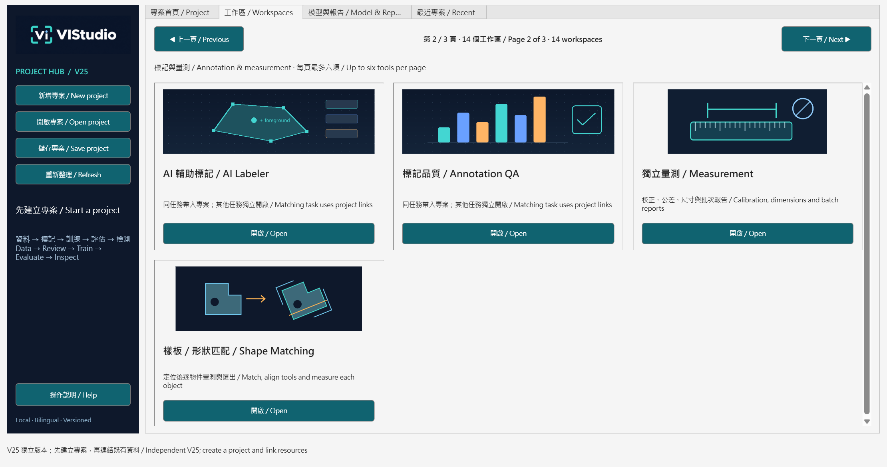
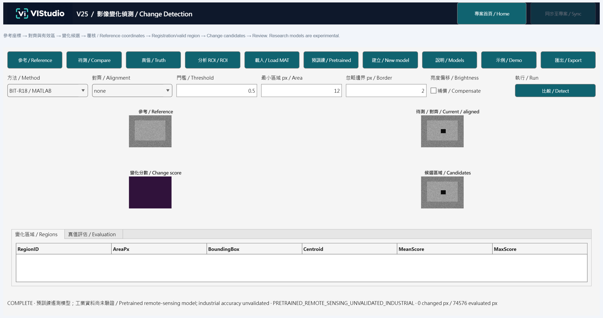
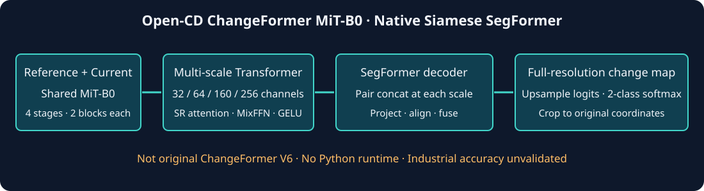

<p align="center">
  
</p>
<h1 align="center">VIStudio Nova</h1>
<p align="center">
  <strong>A MATLAB visual inspection studio — annotation, training, evaluation and measurement</strong><br>
  <strong>MATLAB 視覺檢測工作台 — 標記、訓練、評估與影像量測</strong>
</p>
<p align="center">
  
  
  <a href="docs/VALIDATION.md"></a>
  
</p>
<p align="center"><a href="#繁體中文">繁體中文</a> · <a href="#english">English</a> · <a href="README.en.md">English-only README</a></p>

---

Build a project from the start page, then follow **Data → Label → Train → Evaluate → Inspect** across fourteen workspaces.

從起始頁建立專案，依 **資料 → 標記 → 訓練 → 評估 → 檢測** 串接十四大工作區。

**Contents · 目錄：** [Start page 起始頁](#start-page) · [Fourteen workspaces 十四大工作區](#workspaces) · [Install & launch 安裝啟動](#install) · [Workflows 操作流程](docs/VISION_WORKFLOWS.md) · [Validation 驗證](docs/VALIDATION.md) · [Release notes 更新紀錄](CHANGELOG.md)

<a id="start-page"></a>

## 起始頁面 / Start page


**從專案開始：**新增／開啟專案，連結影像、標記、模型與報告，再進入對應工作區。<br>
**Start with a project:** create/open a project, link images, annotations, models and reports, then choose your workspace.

<a id="workspaces"></a>

## 十四大工作區 / Fourteen workspaces

點擊圖片可放大檢視。部分截圖來自沿用的既有版本工作區；畫面中的版本號與示例數值不代表 V25 模型效能驗證。<br>
Click any image to view it at full size. Some screenshots show retained workspaces from earlier versions; their version labels and example numbers are not V25 model-performance validation.

<table>
<tr>
<td width="50%" valign="top">
      <p><strong>01 · 影像分類<br>Classification</strong></p>
      <a href="docs/images/features/classification.png"></a>
      <p>選擇模型、檢視資料分布與照片，設定訓練及分類檢測。</p>
      <p>Select models, browse images and class distributions, then configure training and inspection.</p>
    </td>
<td width="50%" valign="top">
      <p><strong>02 · 物件偵測<br>Object detection</strong></p>
      <a href="docs/images/features/detection.png"></a>
      <p>定位、分類與計數；提供訓練設定、方框檢測與模型視覺化。</p>
      <p>Locate, classify and count objects with training controls, box results and model visualization.</p>
    </td>
</tr>
<tr>
<td width="50%" valign="top">
      <p><strong>03 · 異常偵測<br>Anomaly detection</strong></p>
      <a href="docs/images/features/anomaly.png"></a>
      <p>設定異常門檻、覆核缺陷，查看混淆矩陣與評估指標。</p>
      <p>Configure anomaly thresholds, review defects and inspect confusion matrices and evaluation metrics.</p>
    </td>
<td width="50%" valign="top">
      <p><strong>04 · 語意分割<br>Semantic segmentation</strong></p>
      <a href="docs/images/features/semantic.png"></a>
      <p>建立像素類別遮罩，配置分割訓練並評估 IoU／Dice。</p>
      <p>Create pixel-class masks, configure segmentation training and evaluate IoU/Dice.</p>
    </td>
</tr>
<tr>
<td width="50%" valign="top">
      <p><strong>05 · 實例分割<br>Instance segmentation</strong></p>
      <a href="docs/images/features/instance.png"></a>
      <p>分開管理物件遮罩與身分，配置模型並分析 mask AP。</p>
      <p>Manage individual object masks and identities, configure models and review mask AP.</p>
    </td>
<td width="50%" valign="top">
      <p><strong>06 · 關鍵點／肢節<br>Keypoints &amp; pose</strong></p>
      <a href="docs/images/features/keypoints.png"></a>
      <p>編輯點位、骨架與可見性，使用範本並分析 PCK／定位誤差。</p>
      <p>Edit landmarks, skeletons and visibility with templates and PCK/localization error analysis.</p>
    </td>
</tr>
<tr>
<td width="50%" valign="top">
      <p><strong>07 · AI 輔助標記<br>AI-assisted annotation</strong></p>
      <a href="docs/images/features/ai-assist.png"></a>
      <p>以 SAM 點位或框提示產生候選，再由人工接受、修正或拒絕。</p>
      <p>Generate candidates from SAM point/box prompts, then accept, correct or reject them.</p>
    </td>
<td width="50%" valign="top">
      <p><strong>08 · 標記品質分析<br>Annotation quality</strong></p>
      <a href="docs/images/features/annotation-quality.png"></a>
      <p>檢查待覆核、微小區域與疑似重複標記，匯出品質報告。</p>
      <p>Review pending images, tiny regions and possible duplicates; export quality reports.</p>
    </td>
</tr>
<tr>
<td width="50%" valign="top">
      <p><strong>09 · 獨立量測<br>Measurement</strong></p>
      <a href="docs/images/features/measurement.png"></a>
      <p>量測距離、圓徑、角度與旋轉尺寸，搭配校正、公差及批次報告。</p>
      <p>Measure distances, diameters, angles and rotated dimensions with calibration, tolerances and batch reports.</p>
    </td>
<td width="50%" valign="top">
<p><strong>10 · 樣板／形狀匹配<br>Shape matching</strong></p>
<a href="docs/images/features/shape.png"></a>
<p>定位每個物件，搬移工具並重新量測，輸出逐物件摘要及工具結果。</p>
<p>Locate each object, transform its measurement tools and export individual remeasured results.</p>
</td>
</tr>
<tr><td colspan="2" valign="top">
<p><strong>11 · 影片 ROI 擷取 / Video ROI extraction</strong></p>
<a href="docs/images/features/video.png"></a>
<p>匯入影片、選定固定 ROI，再依影格間隔或每秒張數裁切儲存。支援起訖範圍、數量上限與停止，保留影格及時間清單。</p>
<p>Load a video, choose a fixed ROI and save crops by frame interval or images/second, with frame bounds, output limits, cancellation and provenance.</p>
</td></tr>
<tr>
<td width="50%" valign="top"><p><strong>12 · 影像拼接 / Image stitching</strong></p><a href="docs/images/features/stitch.png"></a><p>對重疊影像做配準、品質檢查及融合，保留有效區與座標變換。</p><p>Register and blend overlapping views with quality gates, valid coverage and coordinate transforms.</p></td>
<td width="50%" valign="top"><p><strong>13 · 影像缺陷合成 / Defect synthesis</strong></p><a href="docs/images/features/synthesis.png"></a><p>產生刮痕、斑點、污漬與貼片，匯出實際變更遮罩及可重現設定。</p><p>Generate procedural defects with exact changed-pixel masks and reproducible settings.</p></td>
</tr>
<tr><td width="50%" valign="top"><p><strong>14 · 影像變化偵測 / Change Detection</strong></p><a href="docs/images/features/change.png"></a><p>比較參考與待測影像，對齊、限定 ROI，檢視變化遮罩及 IoU／Dice，匯出各變化區域。</p><p>Align image pairs, inspect ROI change maps, evaluate IoU/Dice and export region evidence.</p></td></tr>
</table>

[樣板匹配評估與操作 / Shape matching assessment and guide](docs/SHAPE_MATCHING.md)

模型功能需對應 Toolbox、支援套件及權重；AI 候選需人工覆核。**162 項檢查涵蓋定位量測、影片擷取、形狀匹配與專案／標記回歸，未驗證所有大型模型或 GPU。**<br>
Model workflows require the relevant toolboxes, support packages and weights. AI candidates require human review. **The 162 checks cover pose-aware measurements, video extraction, native shape matching and measurement and project/annotation regressions, not all large models or GPU configurations.**

[各功能操作與資料格式 / Workspace workflows and data formats](docs/VISION_WORKFLOWS.md) · [量測手冊 / Measurement guide](docs/USER_GUIDE.md) · [影片擷取 / Video ROI](docs/VIDEO_EXTRACTION.md) · [範例庫評估 / Example-library assessment](docs/EXAMPLE_LIBRARY_ASSESSMENT.md)

---

## 繁體中文

VIStudio 是以 MATLAB 建立的**視覺檢測工作台**。從起始頁面建立或開啟專案，管理資料、標記、模型與評估結果，再依任務進入對應工作區。

整體流程為 **資料 → 標記 → 訓練 → 評估 → 檢測**，整合影像分類、物件偵測、異常偵測、語意／實例分割、關鍵點、AI 輔助標記與品質分析。V25 新增 MATLAB 原生 Open-CD ChangeFormer MiT-B0 變體與預訓練權重，延續 BIT 與 FC-Siam，延續拼接、缺陷合成、逐物件量測與影片 ROI 擷取。工作區使用左右分頁，各主要介面統一為 V25。

本包為 **v25.0.0 MATLAB 原始碼版本**，需要 MATLAB 與對應 Toolbox。V25 已加入影像變化偵測工作區。

### 起始頁面與專案工作台

啟動 `start_VIStudio` 後，首先進入專案首頁。首次使用可按左側「新增專案」，已有專案則按「開啟專案」。

[查看起始頁面截圖](#start-page)

| 首頁區域 | 用途 |
|---|---|
| 左側專案操作 | 新增、開啟、儲存與重新整理專案，查看目前任務及操作說明 |
| 專案首頁 | 查看影像數、類別、覆核進度、待確認標記、模型狀態及檔案連結 |
| 五步驟導航 | 依資料、標記、訓練、評估、檢測進入工作區；「下一步」提供建議 |
| 工作區 | 選擇分類、偵測、分割、標記、量測等工具 |
| 模型與報告 | 查看已連結模型、報告摘要與環境資訊 |
| 最近專案 | 重新開啟最近使用的專案，或重新定位搬移後的專案檔 |

首頁進度依**已保存並連結的檔案**顯示；工作區內尚未同步的變更不會自動反映到首頁。模型已連結不等於訓練／推論已驗證，報告已連結也不等於驗收通過。

### 環境需求

本次在 **Windows、MATLAB R2026b** 驗證。

| 用途 | 需求 |
|---|---|
| 影像拼接 | Image Processing Toolbox、Computer Vision Toolbox |
| 缺陷合成 | Image Processing Toolbox；不需 AI 模型權重 |
| 新量測工作室 | MATLAB R2026b、Image Processing Toolbox、Visual Inspection Toolbox |
| 鏡頭校正／既有視覺流程 | Computer Vision Toolbox；其他功能依使用的工具另有需求 |
| 深度學習訓練／推論 | Deep Learning Toolbox、對應模型支援套件與權重；GPU 為選用 |
| COCO 官方評估／多邊形交換 | 選用：MATLAB 支援的 Python、numpy、pycocotools；量測不需 Python |

只找到 API 不代表已驗證授權取用、實體量測精度或所有模型。此發布包附帶四份有來源及授權記錄的 FC-Siam／BIT／Open-CD ChangeFormer 變體原生預訓練權重；不附 MathWorks Toolbox、Python 二進位套件及本機私人資料集。

<a id="install"></a>

### 安裝與啟動

1. 將此資料夾上傳至 GitHub，或下載並解壓縮整份發布包。
2. 在 MATLAB 將目前資料夾切換到含本 README 的目錄。
3. 執行：

```matlab
start_VIStudio
```

直接開量測工具：

```matlab
if isfolder(fullfile(pwd, 'src')), addpath(fullfile(pwd, 'src')); end
app = VIStudioMeasurementAppV25;
```

不用 `genpath` 加入整個專案；`start_VIStudio` 只加入 `src`，避免測試與範例檔干擾搜尋路徑。`src` 已移除未使用的歷史入口與實作。保留下來的版本化檔案是 V25 仍需使用的後端，不是舊版發布包。

### 建立第一個專案與操作流程

1. **建立專案**：填寫名稱、選擇任務與專案資料夾；既有專案可直接開啟。
2. **連結資料**：選擇影像、標記工作、資料集、模型或評估報告，再按「連結／定位」。檔案搬移後使用同一入口重新指定位置。
3. **標記與覆核**：進入標記工作區建立真值；AI 候選需接受、修正或拒絕，完成覆核後再匯出對應資料集。
4. **設定與訓練**：選擇模型、參數、資料擴充及資料切分；依所選方法準備支援套件與權重。
5. **獨立評估**：使用 validation/test 資料查看任務指標與錯誤案例；異常模型依需要使用獨立校準資料設定門檻。
6. **檢測與保存**：執行單張或批次檢測，匯出結果。在專案工作區按「同步至專案」，再回首頁重新整理。

專案檔管理資源路徑與設定，不會自動打包所有外部影像與模型。詳細資料格式及各任務步驟見 [視覺工作流程](docs/VISION_WORKFLOWS.md)。

### 工作區與功能總覽





每頁最多六項；使用「上一頁／下一頁」切換，視窗較小時可捲動卡片區域。

| 工作區 | 主要用途 |
|---|---|
| 影像分類 | 依整張影像判斷類別，管理資料分布、訓練及分類檢測 |
| 物件偵測 | 定位物件、分類、計數並檢視方框結果 |
| 異常偵測 | 檢查異常區域、設定門檻、評估與缺陷分析 |
| 語意分割 | 建立像素類別遮罩並進行分割訓練與評估 |
| 實例分割 | 分開保存每個物件的遮罩與身分，進行實例檢測與評估 |
| 關鍵點／肢節 | 編輯點位與骨架，訓練／檢測點位並分析 PCK 與誤差 |
| AI 輔助標記 | 透過可用模型提出候選，再由人工覆核 |
| 標記品質 | 檢查疑似重複、微小區域、缺點與標記一致性 |
| 獨立量測 | 無需模型即可量測距離、尺寸與角度，設定校正及公差 |
| 樣板／形狀匹配 | 單張樣板定位後搬移量測工具，逐物件重新量測與匯出 |
| 影片 ROI 擷取 | 固定 ROI 裁切，依每隔 N 影格或每秒 N 張儲存，保留來源清單 |
| 影像拼接 | 相鄰重疊影像配準、品質檢查、接縫融合與座標匯出 |
| 缺陷合成 | 刮痕、斑點、污漬與貼片；匯出變更遮罩、種子及來源群組 |

各模型需要對應資源；工作區存在不代表全部模型已完成實測。量測可直接啟動，不必先建立模型專案。

### 操作說明與文件

首頁「操作說明 / Help」提供中英對照、中文及 English 顯示，說明專案建立、資料連結、流程導航、同步與缺檔處理。


詳細文件：[視覺工作流程](docs/VISION_WORKFLOWS.md) · [量測操作手冊](docs/USER_GUIDE.md)。

### 獨立量測工作區

量測是 VIStudio 的其中一個工作區。可從「工作區 → 獨立量測」開啟，也可直接執行 `VIStudioMeasurementAppV25`。


支援距離、原生卡尺邊對、圓徑、角度、點到線距離、遮罩面積與旋轉尺寸，並提供校正、公差、Undo/Redo、保存、配方、批次與報告。

**量測工作階段／配方獨立保存，目前未加入模型專案五步驟的資源欄位。**

> 以下量測畫面使用程式生成的合成示例，展示流程，不代表實體樣件的精度認證。

#### 量測示範與校正

1. 在首頁「工作區」選 **獨立量測 / Measurement**。
2. 按 **Demo**，載入本專案合成的板件與圓形。
3. 選工具並按 **Place**，在畫布建立或拖曳量測位置。
4. 設定名稱及公差，按 **Capture** 建立一筆量測。
5. 選取結果列後拖曳工具，再按 **Update** 更新該筆；可 Undo。
6. 按 **Export**，選父資料夾，系統在新資料夾匯出報告。

原生畫布的座標／標籤以 **px** 為準；結果表的 **Unit** 欄才是保存的量測單位。卡尺固定執行邊對偵測；Snap 開關作用於圓、角度與點到線。


**毫米流程：先校正，再建立量測。** 比例校正可輸入 X/Y mm/px，或用已知長度線段建立等向比例。校正變更會清空目前量測，可用 Undo 還原。圓徑 mm 要求 X/Y 比例相同；不相同時會記錄未能量測，避免把橢圓當成圓。角度單位始終為 `deg`，面積為 `px^2` 或 `mm^2`。

#### 量測結果判讀

| 狀態 | 意義 |
|---|---|
| `MEASURED` | 有量測值，但沒有設定公差；不表示合格 |
| `OK` | 有量測值，且符合已設定的界限，含邊界 |
| `NG` | 有量測值，且超過已設定的界限 |
| `NOT_MEASURED` | 未找到所選邊對、幾何退化、校正不符或其他量測失敗；值為 NaN，附原因 |
| 批次 `REVIEW` / `ERROR` | 含未能量測項目，或該張影像無法依配方處理；其他影像繼續 |


#### 量測工作階段、配方與匯出

- **Save / Open**：保存內嵌原始影像、校正、量測定義與紀錄。載入時重新計算結果並核對影像雜湊。
- **Recipe / Apply**：保存量測定義與校正，套用到相同解析度、相同視角／定位的影像；本版不提供自動對齊。
- **Batch**：選多張影像，依目前配方量測。影像尺寸不符與其他錯誤會保留在批次摘要。
- **Export**：匯出 `measurements.csv`、`measurements.mat`、量測影像、疊圖與可重新開啟的工作階段。

```text
report/
  measurements.csv
  measurements.mat
  measurement-image.png
  measurement-overlay.png
  measurement-session.mat
```


遮罩必須與目前量測影像同尺寸，使用灰階二值圖；旋轉尺寸只接受一個連通物件。原生吸附的點到線量測須在新影像重新擷取；批次固定幾何請使用未吸附的點到線配方。

#### 量測程式介面

```matlab
addpath('src')
[image, definitions] = VIStudioMeasurementDemoV17;
data = VIStudioMeasurementV17;
data.loadImage(image, 'synthetic-demo');
s = definitions{1};
data.add(s.Kind, s.Geometry, s.Options); % 原生卡尺
disp(data.table())
recipeFile = [tempname '.mat'];
data.saveRecipe(recipeFile)
```

輸出路徑必須是新檔／新資料夾；不會覆寫既有工作或報告。完整 API、校正與批次範例見 [操作手冊](docs/USER_GUIDE.md)。

### 驗證與限制

```matlab
results = run_validation;
```

發布驗證結果與明確範圍放在 [VALIDATION](docs/VALIDATION.md) 與 `validation/`。可先執行 `verify_release` 比對發布檔案。測試包括原生量測數值、失敗狀態、校正、工作階段、配方、批次、可見視窗換圖，以及既有專案／標記整合。合成測試不替代實體標準件、重複性與再現性驗證。

本版未宣稱驗證所有大型模型、GPU 訓練、所有滑鼠／原生對話框流程、長時間負載、其他作業系統，尚未提供 compiled standalone executable。

### 專案結構

```text
start_VIStudio.m          啟動 V25
run_validation.m          執行隨包測試
src/                      應用程式、穩定後端與本機圖像資產
examples/                 不需要模型的合成量測範例
tests/                    本版量測與既有工作區整合測試
docs/                     操作手冊、截圖、驗證範圍
validation/               發布時的驗證摘要
RELEASE_MANIFEST.json      發布檔案清單
SHA256SUMS                 檔案雜湊
```

不要上傳自己的影像、權重、工作階段或執行產物；本包的 `.gitignore` 已列出常用產物路徑。原始碼發布包沒有私人資料集、私人權重、`.git` 歷史、備份或本機執行日誌。

### 回報問題與後續規劃

請在 GitHub Issues 提供 MATLAB 版本、Toolbox、操作步驟、錯誤訊息及可分享的最小範例。請參考 [CONTRIBUTING](CONTRIBUTING.md)。

下一版優先評估基準圖配準與 Change Detection，之後再接「定位 → 比對 → 量測 → OK/NG」產品配方。

初始專案 README 記錄的建置者為 **Fred Liu 與 Tim Yeh**。發布包僅附最新版文件與目前需要的元件。授權狀態及第三方項目見 [LICENSE_STATUS](LICENSE_STATUS.md) 與 [THIRD_PARTY_NOTICES](THIRD_PARTY_NOTICES.md)。

### 官方參考

- [Visual Inspection Toolbox：量測](https://www.mathworks.com/help/visual-inspection/measurement-alignment.html)
- [建立邊緣吸附量測 App](https://www.mathworks.com/help/visual-inspection/ug/create-an-app-to-measure-images-using-edge-snapping-metrology.html)

---

## English

VIStudio is a MATLAB **visual inspection workspace**. Start on the homepage to create or open a project, organize images, annotations, models and reports, and enter the workspace for your task.

The main workflow is **Data → Label → Train → Evaluate → Inspect**. The application brings together classification, object and anomaly detection, semantic/instance segmentation, keypoints, AI-assisted annotation and annotation quality analysis. V25 adds native Open-CD ChangeFormer MiT-B0 variant weights alongside BIT and FC-Siam alongside stitching, synthesis, pose-aware measurement and video ROI extraction, with paged workspaces and consistently versioned V25 frontends.

This is **MATLAB source release v25.0.0**, requiring MATLAB and the relevant toolboxes. V25 includes the Change Detection workspace.

### Start page and project hub

Running `start_VIStudio` opens the project homepage. On first use, choose New project in the sidebar; use Open project to continue existing work.

[View the start-page screenshot](#start-page)

| Homepage area | Purpose |
|---|---|
| Sidebar | Create, open, save and refresh projects; view the current task and help |
| Project | Review image/class counts, annotation review progress, pending candidates, model state and resource links |
| Five-stage navigation | Open Data, Label, Train, Evaluate or Inspect; Next recommends an action |
| Workspaces | Choose a vision, annotation or measurement tool |
| Model & Report | Inspect linked resources, report summaries and environment information |
| Recent | Reopen recent projects or locate moved project files |

Progress reflects **saved, linked artifacts**. Unsynchronized workspace changes are not automatically reflected on the homepage. A linked model does not prove verified training/inference, and an attached report does not establish acceptance.

### Requirements

Validated on **Windows with MATLAB R2026b**.

- Stitching: Image Processing Toolbox and Computer Vision Toolbox.
- Defect synthesis: Image Processing Toolbox; no AI weights.

- Measurement studio: MATLAB R2026b, Image Processing Toolbox, Visual Inspection Toolbox.
- Camera calibration and existing vision workflows: Computer Vision Toolbox as applicable.
- Deep learning workflows: Deep Learning Toolbox and task-specific support packages/weights. GPU is optional.
- Optional official COCO evaluation/polygon conversion: a supported Python environment with numpy and pycocotools. Measurement requires no Python.

Four licensed Open-CD FC-Siam/BIT/ChangeFormer-variant native MAT checkpoints are bundled with attribution and provenance. Toolbox code, Python binaries, private datasets and MATLAB Compiler outputs are not bundled. API presence alone does not prove license availability or validated model performance.

### Install and launch

Download/unzip the entire release or clone the uploaded repository. In MATLAB, select the directory containing this README and run:

```matlab
start_VIStudio
```

For measurement only:

```matlab
if isfolder(fullfile(pwd, 'src')), addpath(fullfile(pwd, 'src')); end
app = VIStudioMeasurementAppV25;
```

Add `src` only, rather than using `genpath` across the repository. Unused historical launchers and implementations have been removed. Remaining versioned files in `src` are required V25 components, not separate old releases.

### Create your first project and follow the workflow

1. **Create a project:** enter its name, task and project folder, or open an existing project.
2. **Link resources:** select images, an annotation session, a dataset, model or evaluation report, then click Link. Use the same action to relocate moved resources.
3. **Annotate and review:** create truth in the annotation workspace. Accept, correct or reject AI candidates before reviewed dataset export.
4. **Configure and train:** select a model, parameters, augmentation and data splits. Install the resources required by the selected method.
5. **Evaluate independently:** use validation/test data for task metrics and error review. Calibrate anomaly thresholds using separate calibration data when required.
6. **Inspect and save:** run single-image or batch inspection and export results. Click Sync in a project workspace, then refresh the homepage.

A project stores resource links and settings; it does not automatically bundle every external image or model. See [Vision workflows](docs/VISION_WORKFLOWS.md) for task-specific data formats and procedures.

### Workspaces and capabilities


Each page contains up to six cards. Use Previous/Next to navigate; the card area scrolls in smaller windows.

| Workspace | Main purpose |
|---|---|
| Classification | Classify whole images, inspect distributions, train and run classification |
| Object detection | Locate, classify and count objects with box results |
| Anomaly detection | Inspect unusual regions, configure thresholds and review defect results |
| Semantic segmentation | Create pixel-class masks and train/evaluate segmentation |
| Instance segmentation | Keep separate object masks/identities and evaluate instance predictions |
| Keypoints & pose | Edit landmarks/skeletons and inspect PCK/error metrics |
| AI-assisted annotation | Generate candidates using available models, followed by human review |
| Annotation quality | Review duplicates, tiny regions, missing points and consistency |
| Independent measurement | Measure dimensions/angles, calibrate units and configure tolerances without a model |
| Shape matching | Localize each object, reposition tools and remeasure the search pixels with a template-bound recipe |
| Video ROI extraction | Crop a fixed ROI and save every N frames or images/second with a source manifest |
| Image stitching | Register adjacent overlapping views, validate quality and export blended mosaics/transforms |
| Defect synthesis | Procedural defects with changed-pixel masks, seeds and source grouping |

Models need their corresponding resources. Workspace availability is not proof that every model has been executed. Measurement can run directly without a model project.

### Help and documentation

The homepage Help button supports bilingual, Chinese and English views. It covers project creation, resource linking, workflow navigation, synchronization and missing-file handling.


Detailed documentation: [Vision workflows](docs/VISION_WORKFLOWS.md) · [Measurement guide](docs/USER_GUIDE.md).

### Independent measurement workspace

Measurement is one of VIStudio's workspaces. Open Workspaces → Measurement, or run `VIStudioMeasurementAppV25` directly.


Tools include endpoint distance, native caliper edge-pair width, circle diameter, angle, point-to-line distance, mask area and rotated dimensions, with calibration, tolerances, Undo/Redo, sessions, recipes, batch processing and reports.

**Measurement sessions/recipes are saved independently and are not added to the model project's five-stage resource fields in this release.**

> Measurement screenshots use generated synthetic fixtures. They demonstrate workflows and do not certify physical measurement accuracy.

#### Measurement walkthrough

1. Choose **Measurement** in the homepage Workspaces tab.
2. Click **Demo** to load the synthetic plate and circle.
3. Select a tool and click **Place**; place or drag its geometry in the viewer.
4. Set a name and optional limits, then **Capture**.
5. Select a row, adjust the tool, and **Update**; Undo restores the previous result.
6. **Export** creates a new report directory under the parent directory you choose.

The native canvas uses **pixel coordinates and annotations**. The result table's **Unit** column describes the stored measurement. Caliper always performs native edge-pair detection. Snap controls circle, angle and point-to-line behavior.

#### Measurement calibration


Configure calibration **before capturing measurements**. Set X/Y mm per pixel, use a known-length line, or load an existing geometry MAT. Changing calibration clears current results; Undo restores them.

Anisotropic scales are supported for distances, angles, point-to-line distances, mask area and rotated dimensions. A physical circle diameter requires equal X/Y scales; otherwise it is not measured. Angles use `deg`; areas use `px^2` or `mm^2`. Lens correction alone does not establish a physical scale.

#### Measurement decisions and failure handling

| State | Meaning |
|---|---|
| `MEASURED` | A value exists, but no tolerance was set; not an acceptance decision |
| `OK` | A finite result satisfies the configured inclusive limits |
| `NG` | A finite result violates a configured limit |
| `NOT_MEASURED` | No requested edge pair, degenerate geometry, invalid calibration or another measurement failure; value is NaN |
| Batch `REVIEW` / `ERROR` | At least one measurement failed, or an image could not use the recipe; later images continue |


#### Measurement sessions, recipes and exports

- **Save/Open** stores the embedded original image, calibration, definitions and records. Loading checks the source hash and recomputes measurements instead of trusting edited stored values.
- **Recipe/Apply** reuses geometry and calibration on the same resolution and expected product pose. This release does not auto-align images.
- **Batch** applies the current recipe and retains per-image failures in its summary.
- **Export** writes CSV, MAT, source-aligned images, overlays and a reloadable session.

```text
report/
  measurements.csv
  measurements.mat
  measurement-image.png
  measurement-overlay.png
  measurement-session.mat
```


Masks must be binary grayscale and match the current measurement image dimensions. Rotated dimensions require a single connected object. Snapped point-to-line captures must be recaptured on a new image; use manual fixed geometry for batch point-to-line recipes.

#### Measurement API

```matlab
addpath('src')
[image, definitions] = VIStudioMeasurementDemoV17;
data = VIStudioMeasurementV17;
data.loadImage(image, 'synthetic-demo');
s = definitions{1};
data.add(s.Kind, s.Geometry, s.Options);
disp(data.table())
recipeFile = [tempname '.mat'];
data.saveRecipe(recipeFile)
```

Output paths must be new files/directories. See the [user guide](docs/USER_GUIDE.md) for calibration, session and batch examples.

### Validation

```matlab
results = run_validation;
```

Run `verify_release` to check the shipped file inventory. The packaged tests cover native numerical measurements, failure states, calibration, portable sessions, transactional recipes, batch handling, visible-viewer image replacement, and existing project/annotation integration. Release evidence is in `validation/` and [VALIDATION](docs/VALIDATION.md).

Synthetic fixtures do not replace calibrated physical artifacts or repeatability/reproducibility studies. Full large-model/GPU execution, every mouse/dialog flow, long-running loads and other operating systems are outside this release's validation scope.

### Repository layout

```text
start_VIStudio.m           Launch V25
run_validation.m           Run packaged tests
src/                       Apps, versioned backends and local assets
examples/                  Model-free synthetic example
tests/                     Measurement/project/annotation tests
docs/                      Guide, screenshots and validation scope
validation/                Release verification summaries
RELEASE_MANIFEST.json       File inventory
SHA256SUMS                  File hashes
```

The release includes only the four documented public pretrained models and excludes private datasets, private weights, sessions, `.git` history, backups and execution logs. `.gitignore` covers common generated artifacts. Do not add your own private data or model files when uploading the repository.

For issues, include MATLAB/toolbox versions, steps to reproduce, errors and a shareable minimal example. See [CONTRIBUTING](CONTRIBUTING.md).

The original README credits the initial build to **Fred Liu and Tim Yeh**. This distribution includes current documentation and required runtime components only. See [LICENSE_STATUS](LICENSE_STATUS.md) and [THIRD_PARTY_NOTICES](THIRD_PARTY_NOTICES.md). No new open-source license is selected by this packaging step.

### References

- [MathWorks measurement documentation](https://www.mathworks.com/help/visual-inspection/measurement-alignment.html)
- [Edge-snapping metrology app example](https://www.mathworks.com/help/visual-inspection/ug/create-an-app-to-measure-images-using-edge-snapping-metrology.html)


### 開發原稿與發布版 / Development and release layouts

開發原稿的 `.m` 檔位於根目錄；發布包放在 `src/`。兩者皆使用 `start_VIStudio` 啟動。V25 新增版本化介面，舊版實作與資料格式保持相容；README 與圖片已從發布版同步回開發原稿。

Development `.m` files are in the repository root; the source release uses `src/`. Both launch through `start_VIStudio`. V25 adds current versioned frontends while retaining legacy implementations and compatible data schemas. The release README and images have been synchronized back to the development source.


### V25 新功能 / New workflows

**定位後逐物件量測：**在樣板匹配開啟「設定量測工具」，於完全相同的裁切樣板記錄工具，再按「套用編輯器」。匹配後自動搬移工具並重新量測，匯出物件摘要、各工具結果與逐物件資料夾。[操作與支援範圍](docs/SHAPE_MATCHING.md)。

**Pose-aware measurement:** configure tools on the exact cropped template and click Use editor. Each match repositions tools and remeasures the search image. Export includes object summaries, tool results and per-object folders. [Guide and supported tools](docs/SHAPE_MATCHING.md).

**影片 ROI 擷取：**在工作區第三頁開啟，選定固定矩形 ROI，設定每隔 N 影格或每秒 N 張，再儲存到新資料夾。[取樣規則與輸出](docs/VIDEO_EXTRACTION.md)。

**Video ROI extraction:** on page three, select a fixed rectangle and sample by frame interval or images/second into a new folder. [Sampling rules and outputs](docs/VIDEO_EXTRACTION.md).

**範例庫暫緩，保留為未來更新考量之一。** 本次不新增範例庫介面或下載服務，既有評估供日後恢復規劃時參考。[優缺點與後續建議](docs/EXAMPLE_LIBRARY_ASSESSMENT.md)。

**The example library is deferred and retained for future consideration.** No library browser/downloader is added; the assessment remains for a later decision. [Benefits, costs and proposed scope](docs/EXAMPLE_LIBRARY_ASSESSMENT.md).


### 影像資料工具與更新方向 / Image data tools and future directions

第三頁集中影片擷取、影像拼接與缺陷合成；第二頁為標記與量測，第一頁為模型與檢測。每頁最多六項。

Page three groups video extraction, stitching and synthesis; page two contains annotation/metrology and page one model tasks. Pages contain at most six cards.

[影像拼接操作 / Stitching guide](docs/IMAGE_STITCHING.md) · [缺陷合成操作 / Synthesis guide](docs/DEFECT_SYNTHESIS.md) · [功能擴充分析與未來考量 / Feature roadmap](docs/FUTURE_FEATURES.md)

**範例庫維持暫緩。** 後續優先候選為合成資料覆核與訓練格式串接、來源群組切分、變化模型的實際資料驗證與拼接品質檢視；未排定交付日期。

**The example library remains deferred.** Future candidates include reviewed synthetic-data adapters, grouped splits, real-data validation of change models and stitch-quality inspection, without committed delivery dates.


### V25 · 影像變化偵測 / Change Detection

從工作區第三頁開啟「影像變化偵測」：載入參考與待測影像 → 選擇對齊方式及 ROI → 使用像素差分或 SSIM → 調整門檻與最小區域 → 覆核遮罩 → 匯出 PNG、CSV 與 MAT。真值遮罩需在參考影像座標；無有效重疊或配準不可靠時拒絕執行。

Open **Change Detection on workspace page three**. Load reference/current images, choose registration and ROI, select absolute difference or SSIM, adjust threshold/minimum area, review and export PNG/CSV/MAT evidence. Ground truth uses reference coordinates. Invalid overlap or unreliable registration is rejected.

可載入本版指定格式的研究模型 MAT。自製小型 **Early Fusion** 與 **Shared Siamese abs-difference** 已做 CPU 推論及合成資料訓練可行性測試；這兩個 tiny 原型不是預訓練檢測器；完整 FC-Siam 已在 V25 另外實作，BIT 已於 V25 整合；Open-CD ChangeFormer MiT-B0 變體已於 V25 整合，原作者 V6 未整合。任意外部 MAT 不會自動轉換成可用模型。

The native research artifact loader supports the documented paired-input contract. Original tiny **Early Fusion** and **shared Siamese abs-difference** prototypes have CPU inference/synthetic-training checks. They are not pretrained inspection models or full paper reproductions. Arbitrary external MAT files are not automatically converted.

Dependencies: Image Processing Toolbox; Computer Vision Toolbox for registration; Deep Learning Toolbox only for research networks. No Python dependency for the baseline workspace.

[操作說明 / User guide](docs/CHANGE_DETECTION.md) · [模型研究與實測範圍 / Model feasibility research](docs/CHANGE_MODELS_RESEARCH.md)

**範例庫維持暫緩 / The example library remains deferred.**


### V25 · MATLAB 原生 FC-Siam / Native FC-Siam

變化偵測的模型下拉選單新增 **FC-Siam-diff** 與 **FC-Siam-conc**。完整四層共享編碼器與多尺度解碼器在 MATLAB 原生建立；支援原生 MAT 權重、雙影像推論、奇數尺寸對齊及單步訓練 API，無 Python 推論依賴。

The Change Detection selector now includes **FC-Siam-diff** and **FC-Siam-conc**. Full four-level shared-encoder/multi-scale-decoder models are created natively in MATLAB, with native MAT checkpoints, paired inference, odd-size alignment and a training-step API. Python inference is not required.


先載入參考影像，再選 FC-Siam 並按 **New model** 測試架構；或按 **Load MAT** 載入已保存的原生權重。新建模型是 **RANDOM_INITIALIZATION**，未完成訓練。本版已附轉換並驗證數值一致性的 Open-CD 預訓練 MAT；任意 `.pth` 不會自動匯入，實際工業檢出率與 GPU 尚未驗證。BIT 已於 V25 整合；Open-CD ChangeFormer MiT-B0 變體已於 V25 整合，原作者 V6 未整合。

Load the reference first, select FC-Siam and choose **New model** for architecture testing, or **Load MAT** for a saved native checkpoint. New models are **RANDOM_INITIALIZATION**, not trained detectors. Converted Open-CD pretrained MAT weights are bundled and probability parity is checked. Arbitrary `.pth` import, real industrial accuracy and GPU execution remain unverified. BIT is integrated in V25; the Open-CD ChangeFormer MiT-B0 variant is integrated; original V6 is not integrated.

[原生架構與權重操作 / Native architecture and weight guide](docs/FC_SIAM_NATIVE.md) · [模型研究 / Model research](docs/CHANGE_MODELS_RESEARCH.md)

範例庫維持暫緩 / The example library remains deferred.


### V25 · 不需重新訓練的 FC-Siam / Ready-to-load pretrained FC-Siam

工作區第三頁 → 影像變化偵測 → 載入參考／待測影像 → 選 FC-Siam-diff 或 FC-Siam-conc → 按 **預訓練 / Pretrained** → Detect。隨附的 Open-CD LEVIR-CD 權重已轉成原生 MAT；載入和推論不需 Python、不需重新訓練，也不需額外下載。按鈕將門檻設為 0.5；**New model 仍是隨機初始化**。

Open Change Detection on workspace page three, load the image pair, select FC-Siam-diff/conc and click **Pretrained**, then Detect. Bundled Open-CD LEVIR-CD weights are converted to native MAT: no retraining, Python inference or extra download is required. The button sets threshold to 0.5. **New model still creates random weights.**


模型庫的發布者標示 Apache-2.0；發布包含授權文字、NOTICE、固定來源版本與原始／轉換後 SHA-256。兩種模型各五組合成配對的逐像素機率比對已通過。前處理、32 倍數補邊與裁回原尺寸均由 MATLAB 處理，不縮放影像；最多 262144 像素（含補邊）。

The publisher model card declares Apache-2.0. The release includes license text, NOTICE, pinned source revision and original/converted SHA-256. Both variants pass per-pixel probability comparisons on five synthetic pairs each. MATLAB applies normalization, padding to multiples of 32 and cropping back, without resizing; padded inputs are limited to 262144 pixels.

**權重是在遙測建築變化資料上訓練，尚未驗證工業瑕疵檢出率。** 數值轉換一致不代表適合每種產品或光照。

**The checkpoints were trained for remote-sensing building changes; industrial defect accuracy remains unvalidated.** Conversion parity does not establish suitability for every product or lighting condition.

[預訓練權重操作、來源與授權 / Pretrained usage, provenance and license](docs/FC_SIAM_PRETRAINED.md) · [原生架構 / Native architecture](docs/FC_SIAM_NATIVE.md)

範例庫維持暫緩 / The example library remains deferred.


### V25 · 原生 BIT-R18 / Native BIT-R18

變化偵測的下拉選單新增 **BIT-R18 / MATLAB**：載入影像 → 選 BIT → 按 **Pretrained** → Detect。隨附 Open-CD LEVIR-CD 預訓練原生 MAT，推論不需 Python、不需重新訓練或額外下載。**New model 是隨機權重。**

Select **BIT-R18 / MATLAB** in Change Detection, load the image pair, click **Pretrained**, then Detect. The bundled native MAT supports direct inference without Python, retraining or another download. **New model creates random weights.**




原生架構含共享 ResNetV1c-18、每圖四個語意 token、一層 token encoder、八層 cross-attention decoder。這是 **Open-CD 改良版 BIT**，不是原作者受非商業限制的程式／checkpoint。權重依發布者模型卡的 Apache-2.0 標示整理，附授權、NOTICE 與 SHA-256。

The native architecture includes shared ResNetV1c-18, four semantic tokens per view, one token encoder and eight cross-attention decoder blocks. It is the **Open-CD improved BIT variant**, with publisher-declared Apache-2.0 weights, attribution, license text and hashes; the original BIT author's restricted implementation/checkpoint is not bundled.

五組原創合成輸入的最大機率差約 5.7e-6，0.5 門檻遮罩一致。這是推論數值一致性，**不是工業瑕疵檢出率驗證**。BIT 訓練 API、GPU、compiled standalone 尚未提供／驗證；Open-CD ChangeFormer MiT-B0 變體已於 V25 整合，原作者 V6 未整合，範例庫維持暫緩。

Five original synthetic pairs show maximum probability error around 5.7e-6 and matching threshold-0.5 masks. This establishes inference parity, **not industrial defect accuracy**. BIT training, GPU and compiled standalone are unimplemented/unvalidated; the Open-CD ChangeFormer MiT-B0 variant is integrated; original V6 is not integrated and the example library remains deferred.

[BIT 操作、架構與授權 / BIT architecture, usage and licensing](docs/BIT_NATIVE.md) · [驗證範圍 / Validation](docs/VALIDATION.md)


### V25 · Open-CD ChangeFormer MiT-B0 變體 / Native variant

影像變化偵測新增 **Open-CD ChangeFormer MiT-B0**：載入參考／待測照，選該模型，按 **Pretrained** 再 Detect。原生 MATLAB MiT-B0、spatial-reduction attention、MixFFN 與多尺度 SegFormer head 可直接使用隨附 MAT 權重，不需 Python 推論或重新訓練。

Change Detection now includes **Open-CD ChangeFormer MiT-B0**. Load the pair, select the model and click **Pretrained**, then Detect. Native MATLAB MiT-B0, spatial-reduction attention, MixFFN and a multi-scale SegFormer head use the bundled MAT without Python inference or retraining.




**這是 Open-CD 的 Siamese SegFormer 變體，不是原作者 ChangeFormer V6，也不是原論文的嚴格重製。** 上游明確揭露此差異；本版依模型庫標示 Apache-2.0 的權重整理授權、NOTICE、固定來源版本與 SHA-256。五組原創合成配對的最大機率差約 3.4e-6，0.5 門檻遮罩一致；工業準確率仍需實測。

**This is Open-CD's Siamese SegFormer variant, not original ChangeFormer V6 or a strict paper reproduction.** The upstream README discloses this distinction. Publisher-declared Apache-2.0 weights include attribution/license text, pinned provenance and hashes. Five original synthetic pairs show maximum probability error around 3.4e-6 with matching threshold-0.5 masks; industrial accuracy is unvalidated.

**BIT 標準照用法：**可固定一張標準照逐張比對其他待測照；兩張標準目前需手動切換，不會自動融合或讓模型學習正常外觀。若要驗證準確率，仍需正常／缺陷測試配對與人工真值。

**BIT references:** keep one standard and compare current images one at a time. Switch a second standard manually; references are not fused and do not train normality. Accuracy assessment requires independent normal/changed pairs and reviewed truth.

[原生變體架構、授權與操作 / Variant architecture and licensing](docs/CHANGEFORMER_NATIVE.md) · [標準照與驗證差異 / Reference-pair guide](docs/REFERENCE_PAIR_GUIDE.md)

ChangeFormer 變體訓練 API、GPU、compiled standalone 尚未提供／驗證。範例庫維持暫緩。

Variant training, GPU and compiled standalone are unimplemented/unvalidated. The example library remains deferred.
