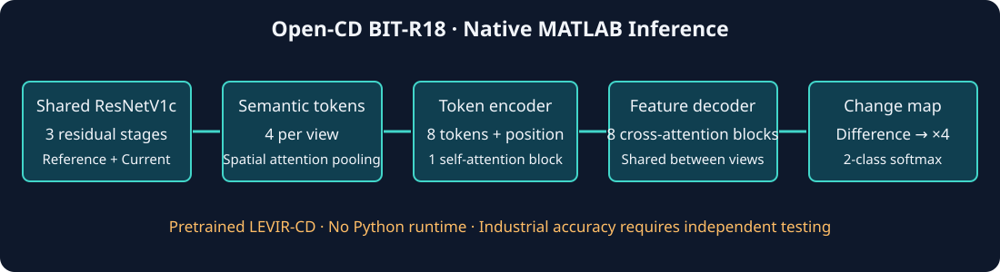
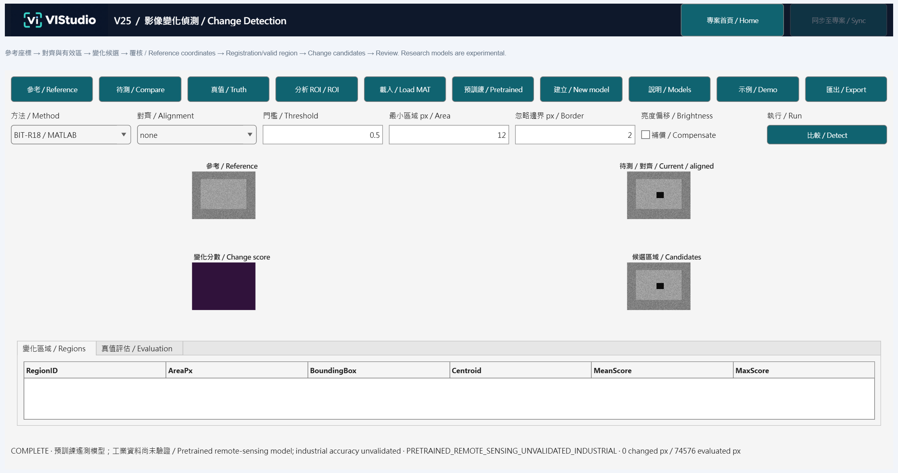

# MATLAB 原生 BIT-R18 / Native BIT-R18

V25 將 **Open-CD 改良版 BIT-R18** 加入變化偵測。共享 ResNetV1c-18、語意 token、Transformer 與前後處理均以 MATLAB 原生函式建立；隨附已轉換的 LEVIR-CD 原生 MAT 權重，可直接推論，不需重新訓練、Python 或額外下載。

V25 integrates the **Open-CD improved BIT-R18 variant** into Change Detection. The shared ResNetV1c-18, semantic tokenizer, Transformer and preprocessing/postprocessing run natively in MATLAB. A converted LEVIR-CD MAT checkpoint is bundled for direct inference, without retraining, Python or another download. Deep Learning Toolbox and the workspace's Image Processing Toolbox are required.





## 架構 / Architecture

| 元件 / Component | 本版設定 / Configuration |
|---|---|
| Shared backbone | ResNetV1c-18 deep stem: three 3×3 convolutions (32/32/64), max pool, three residual stages (64/128/256), two basic blocks per stage; strides 1/2/1 |
| Preprocess feature | Bilinear ×2, 3×3 256→32 convolution and ReLU |
| Semantic tokenizer | ReLU 1×1 32→4 attention maps; spatial softmax weighted pooling; four 32-dimensional tokens per image |
| Token encoder | Eight concatenated tokens, learned 1×8×32 positional embedding; one pre-norm self-attention/feed-forward block |
| Feature decoder | Eight shared cross-attention/feed-forward blocks; each view attends to its four encoded tokens |
| Attention | Eight heads, projected width 64 (eight dimensions/head); Open-CD attention scale is **1/√32**, not the usual per-head scale |
| Norm / MLP | LayerNorm epsilon 1e-5; 32→64→32 feed-forward with ReLU |
| Segmentation | Absolute difference of decoded features, bilinear ×4, 1×1 32→2 classifier and softmax `[unchanged, changed]` |
| Native representation | Versioned MATLAB artifact with 225 named numeric tensors; native `dlconv`/`maxpool` and MATLAB matrix operations; inference only |

不是匯入 ONNX 或呼叫 Python 模型，也不是原作者 BIT checkpoint 的直接包裝。本版依 [Open-CD BIT 設定](https://github.com/likyoo/open-cd/blob/main/configs/_base_/models/bit_r18.py) 與 [BITHead 架構](https://github.com/likyoo/open-cd/blob/main/opencd/models/decode_heads/bit_head.py) 獨立實作。原論文：[Remote Sensing Image Change Detection with Transformers](https://arxiv.org/abs/2103.00208)。

This is an independent native implementation of the Open-CD configuration, rather than an ONNX import/Python wrapper or the original BIT author's checkpoint. The native artifact is a functional MATLAB architecture, not a single imported `dlnetwork` or a `trainnet` training package.

## 權重與授權 / Weights and licensing

採用 [Open-CD 官方模型庫](https://huggingface.co/likyoo/Open-CD_Model_Zoo) 的 `LEVIR-CD/bit_r18_256x256_40k_levircd.pth`，固定 revision `6b88e874f8dea7430a2ab1ed84b356c6a67128a0`。發布者模型卡標示 **Apache-2.0**；轉換檔、授權文字、NOTICE、原始與轉換後 SHA-256 位於 `src/VIStudio_BIT_Pretrained_V24`（開發原稿同名資料夾位於根目錄）。沒有附帶訓練影像或上游 Python 程式。

The bundled checkpoint comes from the publisher's Open-CD Model Zoo, whose model card declares **Apache-2.0**. The pinned source revision, original/converted hashes, license text and modification/attribution notice are included with the native MAT. Training imagery and upstream Python implementation are excluded. This does not assign a new license to VIStudio as a whole.

[原作者 BIT 專案](https://github.com/justchenhao/BIT_CD) 的 README 另有研究／非商業限制；其程式與權重未放入本發布包。本版使用的是 Open-CD 另外發布的改良版與權重，不能把兩個來源的授權混為一談。授權狀態依發布者提供的模型卡記錄，不宣稱取得第三方訓練影像的所有權。

The original BIT author's repository has research/noncommercial terms. Its implementation/checkpoints are not bundled. This release uses the separately published Open-CD variant/checkpoint and records the publisher's model-card terms; it does not assert ownership of third-party training imagery.

## 使用 / Use

1. `start_VIStudio` → 工作區第三頁 → 影像變化偵測。Open Change Detection on page three.
2. 載入參考與待測 RGB 影像。Load the reference/current pair.
3. 選 **BIT-R18 / MATLAB**，按 **Pretrained**，再按 Detect。Select BIT and load pretrained weights; threshold defaults to 0.5.
4. 可設定 ROI、配準、最小區域與真值，再匯出 PNG／CSV／MAT。Review ROI/registration/regions, evaluate truth and export evidence.

**New model 為隨機初始化；Pretrained 才會載入已訓練權重。** Load MAT 支援本版 `VIStudioBITWeights` checkpoint，並依已載入參考影像設定網路輸入尺寸，不縮放像素。`artifact` 或任意 `.pth` 並非 BIT 的載入契約。

**New model creates random weights; Pretrained loads learned weights.** Load MAT accepts the versioned native BIT checkpoint and adapts its input geometry to the loaded reference without resizing pixels. Arbitrary `.pth` or `artifact` MAT files are not automatically converted into BIT.

```matlab
addpath('src');
folder = fullfile(fileparts(which('VIStudioBITV25')), 'VIStudio_BIT_Pretrained_V24');
model = VIStudioBITV25.loadWeights(fullfile(folder,'bit-r18-levircd.mat'), size(reference));
[score, probabilities] = VIStudioBITV25.predict(model, reference, current);
mask = score >= 0.5;
% reference/current: same HxWx3 numeric RGB [0,1].
```

RGB `[0,1]` 依 ImageNet mean `[.485 .456 .406]`／std `[.229 .224 .225]` 正規化，右／下補正規化後的零值至 32 倍數，最後裁回原尺寸；呼叫端不要重複正規化。至少 16×16，補邊後最多 262144 像素。沒有自動分塊或靜默縮放。前處理及類別順序寫入 checkpoint 契約，載入時檢查所有 tensor 名稱、形狀、single 精度、有限值及非負 BN variance。

MATLAB applies ImageNet RGB normalization, normalized-zero padding to multiples of 32 and final cropping. Pass raw RGB `[0,1]`; avoid double normalization. Inputs must be at least 16×16 and fit 262144 pixels after padding. All tensor names/shapes, single precision, finite values and BN variance are checked. No automatic tiling or silent resizing is implemented.

## 驗證與限制 / Evidence and limits

五組自製合成配對涵蓋 64×64、96×128、65×67、256×256 與相同影像。與原始權重的 PyTorch 參考比較 backbone 及雙類別機率；觀測到最大機率差約 **5.7×10⁻⁶**，0.5 門檻遮罩一致。驗收容差為 `1e-4`，詳見 [數值證據](../validation/bit-native-parity.json)。一次性 Python 參考流程使用經檢視的 Open-CD BITHead 與獨立的等價 ResNet 前向計算，未安裝整套 OpenMMLab；相同的原創 fixtures 可讓 `run_validation` 在沒有 Python 的環境重跑 MATLAB 比對。

Five original synthetic pairs cover square/non-square, padded odd dimensions and identical images. Backbone features and both probability channels are compared against the source weights; observed maximum probability error is approximately **5.7e-6**, with matching threshold-0.5 masks. Acceptance tolerance is `1e-4`. The one-time reference harness uses the reviewed Open-CD BITHead with minimal evaluation-only support classes and an equivalent functional ResNet forward, without the full OpenMMLab stack. Native fixtures allow Python-free regression checks. See [parity evidence](../validation/bit-native-parity.json).

**本版只提供 BIT 原生推論，尚未實作 BIT 訓練 API、GPU、compiled standalone 或工業缺陷準確率驗證。** 權重為遙測建築變化資料訓練；數值一致不等於適用所有工業產品。分數需依實際正常／缺陷配對資料調整及覆核。V25 已加入 Open-CD ChangeFormer MiT-B0 變體，原作者 V6 未整合；範例庫維持暫緩。

**BIT training, GPU, compiled standalone and industrial defect accuracy are unvalidated/unimplemented in this release.** The pretrained domain is remote-sensing building changes. Numerical parity does not establish industrial suitability. V25 adds the Open-CD ChangeFormer MiT-B0 variant; original V6 is not integrated. The example library remains deferred.


## 標準照如何使用 / Standard reference photos

一張 Reference 可逐張比對 Compare；第二張標準照需手動切換，不會自動學習、融合或批次驗證。參考照不是正常模型訓練資料，工業準確率評估需要獨立配對與真值。 / One reference can be reused against sequential comparisons; a second standard is selected manually. References do not teach normality. See [reference-pair guide](REFERENCE_PAIR_GUIDE.md).
