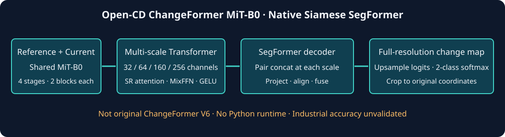
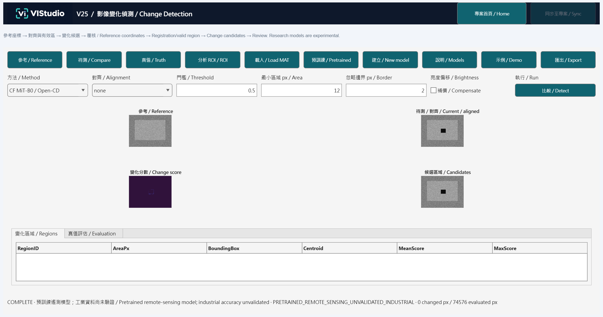

# Open-CD ChangeFormer MiT-B0 / MATLAB 原生變體

V25 新增 **Open-CD ChangeFormer MiT-B0** 的 MATLAB 原生推論，隨附可直接載入的 LEVIR-CD 原生 MAT 預訓練權重，不需重新訓練、Python 或額外下載。需要 Deep Learning Toolbox 與變化偵測工作區既有的 Image Processing Toolbox。

V25 adds native MATLAB inference for **Open-CD ChangeFormer MiT-B0**, with a bundled pretrained LEVIR-CD MAT checkpoint. No retraining, Python runtime or another download is required. Deep Learning Toolbox and Image Processing Toolbox are required.

**版本差異：這是 Open-CD 發布的 Siamese SegFormer 變體，不是原作者 ChangeFormer V6，也不是原論文的嚴格重製。** 上游 [ChangeFormer 說明](https://github.com/likyoo/open-cd/tree/main/configs/changeformer) 明確揭露此差異。原作者程式及 checkpoint 未附帶，介面與 checkpoint metadata 都保留變體標示。

**Variant disclosure: this is Open-CD's Siamese SegFormer variant, not the original author's ChangeFormer V6 or a strict paper reproduction.** The upstream model README explicitly notes this distinction. Original-author code/checkpoints are not bundled. The UI and checkpoint metadata identify the Open-CD variant.





## 架構 / Architecture

| 元件 / Component | 設定 / Configuration |
|---|---|
| Shared encoder | MiT-B0 four stages, widths 32/64/160/256, two blocks per stage; shared weights for both images |
| Patch embedding | Overlapping convolutions: 7×7 stride4 then 3×3 stride2; channel LayerNorm |
| Efficient attention | Heads 1/2/5/8; spatial-reduction ratios 8/4/2/1; standard per-head scaling, Q/K/V projections and residuals |
| MixFFN | 1×1 C→4C, channel-wise 3×3 depthwise convolution, exact GELU, 1×1 4C→C and residual |
| Normalization | MiT LayerNorm epsilon 1e-6; segmentation-head BN epsilon 1e-5 |
| Siamese fusion | Concatenate reference/current features at each of four scales, retaining pair order |
| SegFormer head | Four 1×1→256 BN/ReLU projections, bilinear alignment at 1/4 scale, concatenate/fuse 1024→256, 1×1 two-class logits |
| Output | Upsample logits to padded full resolution, softmax `[unchanged, changed]`, crop to original frame |
| Artifact | Versioned native MATLAB model with 187 numeric tensors; native `dlconv`/grouped convolution and matrix operations; inference only |

架構依 [Open-CD 設定](https://github.com/likyoo/open-cd/blob/main/configs/_base_/models/changeformer_mit-b0.py) 與 [MMSegmentation MiT](https://github.com/open-mmlab/mmsegmentation/blob/main/mmseg/models/backbones/mit.py)、[SegFormer head](https://github.com/open-mmlab/mmsegmentation/blob/main/mmseg/models/decode_heads/segformer_head.py) 獨立實作，不是 ONNX 匯入或 Python 呼叫。參考論文：[ChangeFormer](https://arxiv.org/abs/2201.01293)、[SegFormer](https://arxiv.org/abs/2105.15203)。

The functional MATLAB architecture is independently implemented from the documented Open-CD/MMSegmentation variant. It is not an imported `dlnetwork`, ONNX wrapper or training package.

## 授權與來源 / License and provenance

權重來自 [Open-CD 官方模型庫](https://huggingface.co/likyoo/Open-CD_Model_Zoo)，模型卡標示 **Apache-2.0**。固定 revision `6b88e874f8dea7430a2ab1ed84b356c6a67128a0`，檔名 `LEVIR-CD/changeformer_mit-b0_256x256_40k_levircd.pth`。發布包的 `src/VIStudio_ChangeFormer_Pretrained_V25` 包含轉換 MAT、完整授權、NOTICE 與原始／轉換後 SHA-256。開發原稿同名資料夾位於根目錄。

Weights come from the publisher's Open-CD Model Zoo with model-card **Apache-2.0** labeling. Pinned revision, source URL/hash, converted hash, license text and modification/attribution notice accompany the native MAT. Training imagery and upstream Python implementations are not included. VIStudio's overall licensing is unchanged.

[原作者 ChangeFormer 專案](https://github.com/wgcban/ChangeFormer) 同時出現 MIT 標示與研究／非商業 README 文字；此來源的權重未使用。本版記錄的是 Open-CD 另外發布的模型卡條款，不宣稱已解決原作者版本的授權差異，也不宣稱擁有訓練影像。

The original ChangeFormer repository has MIT labeling alongside research/noncommercial README language. Its checkpoint is not used here. This bundle records the separately published Open-CD terms and does not claim to resolve the original repository's terms or ownership of training imagery.

## 使用 / Use

1. `start_VIStudio` → 工作區第三頁 → 影像變化偵測。Open Change Detection on page three.
2. 載入同視野的參考照與待測照。Load the matching reference/current pair.
3. 選 Open-CD ChangeFormer B0，按 **Pretrained**，再按 Detect。Select the Open-CD B0 variant, click Pretrained, then Detect; threshold defaults to 0.5.
4. 可限制 ROI、配準、覆核變化區域、載入真值並匯出。Configure ROI/registration, review changes, evaluate truth and export evidence.

New model 建立隨機權重，不代表已有檢出能力。Load MAT 接受本版 `VIStudioChangeFormerWeights` checkpoint，依已載入參考照調整輸入尺寸，不縮放影像。任意 `.pth` 或原作者 V6 checkpoint 不會自動轉換。

New model creates random weights. Load MAT accepts the native checkpoint and adapts input geometry to the loaded reference without resizing pixels. Arbitrary `.pth` and original V6 checkpoints are not automatically converted.

```matlab
addpath('src');
folder = fullfile(fileparts(which('VIStudioChangeFormerV25')), 'VIStudio_ChangeFormer_Pretrained_V25');
model = VIStudioChangeFormerV25.loadWeights(fullfile(folder,'opencd-changeformer-b0-levircd.mat'), size(reference));
[score, probabilities] = VIStudioChangeFormerV25.predict(model, reference, current);
mask = score >= 0.5;
% Same HxWx3 numeric RGB [0,1]; no extra caller-side normalization.
```

採 ImageNet RGB mean/std、正規化後補零至 32 倍數、half-pixel bilinear 插值與原尺寸裁切。至少 16×16，補邊後最多 262144 像素；沒有自動大圖分塊。所有參數名稱／形狀／single 精度／有限值與 BN variance 均有檢查。

Preprocessing uses ImageNet RGB mean/std, normalized-zero pad32, half-pixel bilinear interpolation and original-frame cropping. Inputs are at least 16×16 and fit 262144 pixels after padding. There is no automatic tiling. Tensor names, shapes, single precision, finite values and BN variance are validated.

## 證據與限制 / Evidence and limits

五組原創合成輸入涵蓋正方形、長方形、65×67 補邊及相同影像；四階段特徵與雙類別機率對照公開權重的 functional PyTorch 參考。觀測最大機率差約 **3.4×10⁻⁶**，0.5 門檻遮罩一致。容差 `1e-4`，數據見 [parity evidence](../validation/changeformer-native-parity.json)。參考流程未安裝整套 OpenMMLab，使用其設定／權重建立獨立 functional 前向計算；這不是完整上游框架的端到端認證。隨附原創 fixtures 可在不安裝 Python 下重跑 MATLAB 測試。

Five original synthetic pairs compare all four encoder stages and both probability channels with an independent functional PyTorch reference from the published configuration/weights. Observed maximum probability error is approximately **3.4e-6**, with matching threshold-0.5 masks; tolerance is `1e-4`. The reference is not a full OpenMMLab installation/end-to-end certification. Native fixtures support Python-free regression checks.

**只提供原生推論；未提供 ChangeFormer 訓練 API，GPU、compiled standalone 與實際工業準確率尚未驗證。** 權重的訓練領域是遙測建築變化。標準照只用來比對，不會讓模型學習正常外觀；沒有變化遮罩不代表直接判定 OK。詳見 [標準照使用與驗證差異](REFERENCE_PAIR_GUIDE.md)。範例庫維持暫緩。

**Native inference only; no training API. GPU, compiled standalone and industrial accuracy remain unvalidated.** The pretrained domain is remote-sensing building changes. References do not teach normality, and an empty mask is not automatic acceptance. The example library remains deferred.
