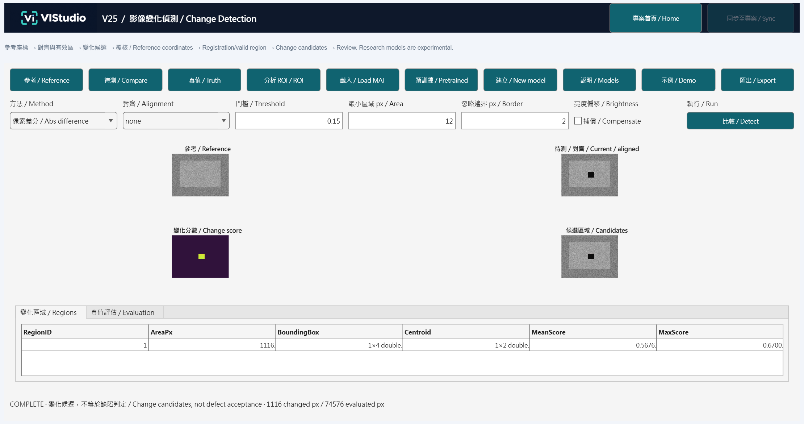

# 影像變化偵測 / Change Detection

V25 的第十四個工作區位於第三頁。可獨立執行 `VIStudioChangeDetectionAppV25`，或從 `start_VIStudio` 開啟。範例庫維持暫緩；內建 Demo 僅產生當次記憶體中的合成影像。

The fourteenth workspace is on page three. Launch `VIStudioChangeDetectionAppV25` directly or through `start_VIStudio`. The example library remains deferred; Demo creates an original synthetic pair in memory only.

1. **Reference / 參考影像**：載入基準影像。所有遮罩、區域及 CSV 座標均以此影像為準。Load the reference; all exported coordinates use this frame.
2. **Compare / 待測影像**：載入同一視野。未對齊模式需同尺寸，不自動縮放。Load the matching view; no-registration mode requires equal dimensions, without automatic resizing.
3. **Alignment / 對齊**：可選 none、translation、rigid、similarity。SURF 配準會檢查特徵、內點數／比例及重投影誤差；低紋理或低重疊應先調整拍攝。Registration requires reliable features and inliers; poor texture/overlap is rejected.
4. **ROI**：在參考影像放置矩形；只分析 ROI 與對齊後有效區的交集。Select a rectangle in the reference; analysis excludes invalid warped pixels and borders.
5. **Method / 方法**：像素差分使用 RGB 最大絕對差；SSIM 使用灰階局部結構差，分數為 `1 − SSIM`，不等於缺陷機率。Abs difference preserves color changes; SSIM measures local grayscale structure. Scores are not calibrated probabilities.
6. **Threshold / 門檻、Area / 最小面積、Border / 邊界**：調整變化候選；SSIM 至少排除六像素邊界。有效 ROI 比例預設至少 75%。Tune candidates; SSIM excludes at least six border pixels. At least 75% valid ROI overlap is required by default.
7. **Truth / 真值**：載入參考座標的二值遮罩，零為背景；IoU、Dice、precision、recall 只計有效區。預測與真值都沒有正樣本時 IoU／Dice 為 NaN，標示原因。Load a binary reference-space mask. Both-empty masks produce undefined IoU/Dice rather than an artificial perfect score.
8. **Export / 匯出**：建立新資料夾，保留 reference/current/aligned PNG、16-bit score、0/255 mask/valid/ROI/truth、疊圖、區域 CSV、評估 CSV 及完整 MAT。Creates a new folder with images, masks, region bounds/centroids, metrics and full report. Bounds use MATLAB pixel coordinates; values remain pixels, without physical calibration.

**亮度偏移補償預設關閉。** 開啟時以有效 ROI 的每通道中位數差做補償，可能隱藏全域真實亮度變化。反光、光照、遮擋與配準誤差仍可能產生候選，需人工覆核。

**Brightness compensation defaults off.** It subtracts a median channel offset and can suppress genuine widespread brightness changes. Reflections, illumination, occlusion and registration errors may remain candidates.

基礎方法需 Image Processing Toolbox；配準另需 Computer Vision Toolbox。研究模型另需 Deep Learning Toolbox。支援單張最多 800 萬像素；不處理透明背景、影片時間序列或自動 NG 判定。

Baseline methods require Image Processing Toolbox; registration also requires Computer Vision Toolbox. Research networks need Deep Learning Toolbox. Inputs are capped at eight million pixels. Transparent images must be flattened first. This workspace does not implement video temporal inference or automatic defect acceptance.

研究 MAT 僅支援本版 `VIStudioChangeModelsV25` 契約，固定輸入大小、不自動縮放。模型權重、前處理及門檻必須另行驗證。[模型研究](CHANGE_MODELS_RESEARCH.md) · [驗證範圍](VALIDATION.md)

Research MAT loading accepts the versioned native artifact contract only, with exact input dimensions. Validate preprocessing, weights and thresholds on independent paired data. [Model research](CHANGE_MODELS_RESEARCH.md) · [Validation](VALIDATION.md)

V25 新增完整 MATLAB 原生 FC-Siam-diff／conc 與嚴格 MAT checkpoint 載入，詳見 [操作與限制](FC_SIAM_NATIVE.md)。

V25 adds full native FC-Siam variants and strict native checkpoint loading. See the [native model guide](FC_SIAM_NATIVE.md).
