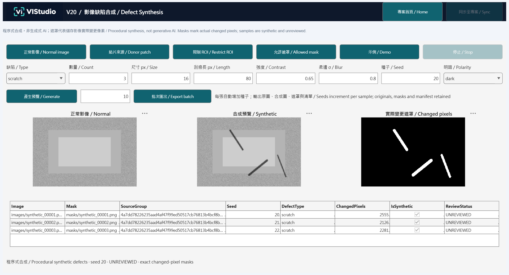

# 影像缺陷合成 / Defect Synthesis

[README](../README.md) · [Future features](FUTURE_FEATURES.md)

工作區第三頁開啟 Defect Synthesis，或執行 `VIStudioDefectSynthesisAppV25`。這是**可重現的程序式影像合成**，不呼叫生成式 AI、外部服務或模型權重，需要 Image Processing Toolbox。

Open Defect Synthesis on page three or run `VIStudioDefectSynthesisAppV25`. This is **reproducible procedural synthesis**, without generative AI, external services or model weights. Requires Image Processing Toolbox.

## 操作 / Workflow

1. 載入正常灰階／RGB 影像；原始檔不被覆寫。 / Load a normal grayscale/RGB image; originals remain unchanged.
2. 選 scratch、spots、stain 或 cutpaste；貼片模式需另載入 donor patch。 / Select scratches, spots, stains or cut-paste; the latter requires a donor patch.
3. 設定繪製次數、尺寸、刮痕長度、強度、柔邊、明暗與種子。 / Configure primitive count, size, scratch length, contrast, blur, polarity and seed.
4. 可畫 Restrict ROI，或載入二值 Allowed mask，限制能改動的區域。 / Optionally restrict the allowed region with an ROI or binary mask.
5. Generate 查看合成圖與**實際變更像素遮罩**。 / Generate and inspect the synthetic image and actual changed-pixel mask.
6. 設定批次張數並 Export batch；Stop 保留部分輸出與清單。 / Export a batch; Stop retains partial outputs and the manifest.



## 四種模式 / Four modes

| 模式 / Type | 行為 / Behavior |
|---|---|
| Scratch / 刮痕 | 隨機方向線段，尺寸控制線寬，長度獨立設定 / Random line direction, size-based width and a separate length |
| Spots / 斑點 | 隨機圓斑，尺寸有種子決定的變化 / Random circular spots with seeded size variation |
| Stain / 污漬 | 柔邊、不均勻強度的局部斑塊 / Soft local blobs with varying intensity |
| Cut-paste / 貼片 | 將使用者提供的 donor 影像縮放貼入局部矩形並融合 / Resize and blend the supplied donor into local rectangles |

Count 是繪製次數，不保證遮罩中有相同數量的獨立連通元件；缺陷可能重疊或被 ROI／邊界截斷。尺寸會做種子控制的隨機變化。Cut-paste 目前不包含前景去背或自動材質匹配；透明來源須先攤平。

Count is the number of drawn primitives, not guaranteed independent mask components. Primitives may overlap or be clipped by the ROI/image. Size varies deterministically with the seed. Cut-paste does not include foreground extraction or automatic texture matching; flatten transparent sources first.

## 遮罩與可重現性 / Masks and reproducibility

柔邊完成後再次套用 Allowed mask，確保外部像素不被修改。最終遮罩比較**輸出整數影像與正常基底**，因此不會把未實際改變的像素標成缺陷。若完全沒有可見變化，會拒絕而不輸出假成功標記。

The allowed mask is reapplied after blur. Final masks compare the integer output with the normal working base, excluding pixels that did not actually change. An invisible/no-change defect is rejected.

8-bit／16-bit 整數輸入保持原位深；浮點輸入先量化為 16-bit，並記錄來源與工作類別。遮罩 PNG 為 0／255。這是合成外觀的變更遮罩，不是實體瑕疵或已覆核真值。

8/16-bit integer inputs retain their depth. Floating inputs use a documented 16-bit working representation. Binary masks use 0/255. These are synthetic appearance-change masks, not reviewed physical-defect truth.

每張使用 `mod(baseSeed + index - 1, 2^32)`；固定來源、donor、ROI 與設定即可重現。使用局部亂數串流，不改動使用者全域 RNG。

Each image uses `mod(baseSeed + index - 1, 2^32)`. Reproduce with the same inputs, region and settings; local random streams preserve the global RNG.

## 匯出 / Export

```text
new-dataset/
  original-normal.png
  donor-patch.png       # cut-paste only
  allowed-region.png
  images/synthetic_00001.png
  masks/synthetic_00001.png
  manifest.csv
  synthesis.json
  synthesis.mat
```

清單包含相對影像／遮罩路徑、來源群組、種子、類型、變更像素數、`IsSynthetic=true` 與 `ReviewStatus=UNREVIEWED`。設定與來源／donor 雜湊一併保存。每次匯出建立新資料夾，最多 500 張，逐張生成與儲存。

The manifest retains relative paths, source group, seed, type, changed-pixel count, `IsSynthetic=true` and `ReviewStatus=UNREVIEWED`. Settings and source/donor hashes are retained. Each run uses a new folder, generating up to 500 images sequentially.

**尚未自動轉成每個訓練工作區的資料格式。** 使用前需覆核、對應類別與遮罩 ID；同來源合成變體應留在同一資料切分群組，真實獨立測試資料仍需保留。未證實這些合成資料能提升特定模型的真實缺陷表現。

**Task-specific training adapters are not automatic.** Review and map classes/mask IDs first. Keep source variants in the same split group and retain independent real test data. Improved real-model performance is not established by generating synthetic samples alone.

批次狀態為 COMPLETE／CANCELLED／ERROR；錯誤與已保存張數保留於 JSON/MAT。來源上限 800 萬像素；高數量、大影像及重度柔邊仍需評估耗時。

Batch status is COMPLETE/CANCELLED/ERROR with saved counts and messages. Sources are limited to 8 million pixels; high counts and large images may take time.
