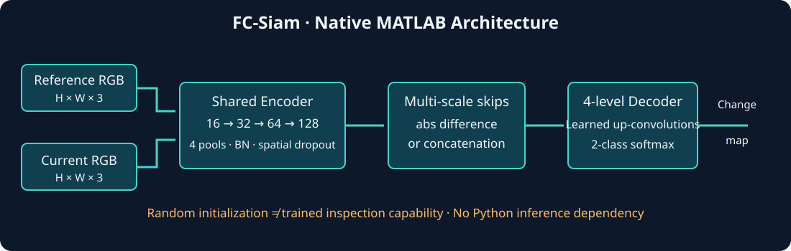
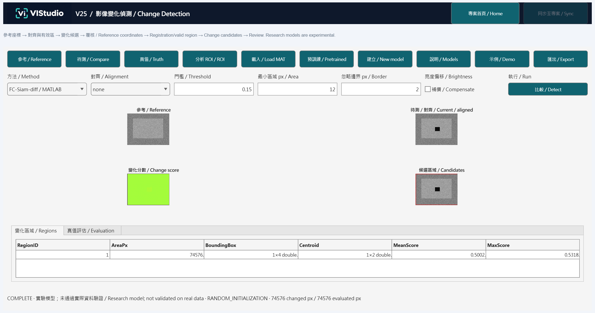

# MATLAB 原生 FC-Siam / Native FC-Siam

V25 提供 **FC-Siam-diff** 與 **FC-Siam-conc** 的完整 MATLAB 原生架構，包含四層共享編碼器、四層多尺度解碼器與雙類別分割輸出。建立模型、載入權重、推論及單步訓練均在 MATLAB 內執行，需 Deep Learning Toolbox；不需要 Python、PyTorch 或 ONNX 轉換套件。

V25 provides full native **FC-Siam-diff** and **FC-Siam-conc** architectures: one shared four-level encoder, a four-level multi-scale decoder and two-class segmentation output. Creation, weight loading, inference and a training-step API run in MATLAB with Deep Learning Toolbox. Python, PyTorch and ONNX converters are not required.





上圖僅示範隨機初始化的原生模型推論介面，不代表已訓練的檢測結果。 / The screenshot demonstrates the native inference UI with random initialization, not trained detection performance.

## 架構 / Architecture

| 部分 / Part | 結構 / Structure |
|---|---|
| 輸入 / Input | Ordered reference/current RGB `single [0,1]`, MATLAB `SSCB` |
| Shared encoder | Channels 16 → 32 → 64 → 128; convolution counts 2 / 2 / 3 / 3; each convolution uses 3×3, BN, ReLU and channel-wise spatial dropout p=0.2; four 2×2 stride-2 max pools |
| Shared weights | Both images use the same encoder object and parameter set; no separately initialized second encoder |
| FC-Siam-diff skips | Absolute encoder-feature differences at all four resolutions |
| FC-Siam-conc skips | Concatenate reference and current encoder features, preserving pair order |
| Decoder | Four learned 3×3 stride-2 transposed up-convolutions; stride-1 transposed-convolution blocks with channels 128/128/64 → 64/64/32 → 32/16 → 16/2; BN/ReLU/channel dropout except final logits |
| Odd dimensions | Floor max pooling, followed by right/bottom replication at skip joins; output matches original dimensions |
| Output | Two-class softmax `[unchanged, changed]`; channel two becomes the workspace change score |

架構依據 [Daudt、Le Saux 與 Boulch 的 ICIP 2018 論文](https://arxiv.org/abs/1810.08462)，並參照[作者架構定義](https://github.com/rcdaudt/fully_convolutional_change_detection)。本版是獨立撰寫的 MATLAB 實作，沒有附帶作者 Python 程式；V25 另附授權明確的 Open-CD 預訓練 MAT。保留作者實作以第二張影像的 pooled feature 作 bottleneck 的設計，因此完整 diff 模型也不保證交換輸入後完全相同。Softmax 機率對應 log-softmax 的指數；Open-CD 預訓練轉換已完成合成配對的跨框架機率比對。

This independently written MATLAB implementation follows the published architecture and the author's architectural definitions. It includes no upstream Python code. V25 separately bundles licensed Open-CD pretrained MAT weights. The bottleneck uses the second image's pooled features, matching the referenced implementation; swapping the pair is therefore not guaranteed to preserve the full diff model's output. Softmax provides probabilities corresponding to exponentiated log-softmax. Open-CD probability parity is checked on original synthetic pairs.

## 工作區 / Workspace

1. 從 `start_VIStudio` → 工作區第三頁 → 影像變化偵測，載入參考與待測影像。Open Change Detection on workspace page three and load both images.
2. 方法選單選 **FC-Siam-diff / MATLAB** 或 **FC-Siam-conc / MATLAB**。Choose the native model variant.
3. 已有原生權重時按 **Load MAT**。要測試架構時按 **New model**，依參考影像尺寸建立隨機模型。Load an existing native checkpoint, or create a randomly initialized model using the reference dimensions.
4. 設定 ROI／對齊、門檻與最小面積後按 Detect。Tune ROI, registration, threshold and minimum area, then run detection.
5. 依既有流程檢視遮罩、評估及匯出。已載入的權重架構若與選單不同會拒絕執行，不切換成基礎差分。Inspect/export masks and evaluation. A variant mismatch or missing weights causes an explicit error, without a baseline fallback.

**New model 只建立隨機權重，沒有完成訓練。畫面上的 RANDOM_INITIALIZATION 不是可用檢測能力的證明。**

**New model creates random weights only. RANDOM_INITIALIZATION does not indicate trained detection capability.**

## 原生權重格式 / Native weights

```matlab
addpath('src'); % source-release layout
artifact = VIStudioFCSiamV25.create('fc-siam-diff', [64 64 3], 22);
VIStudioFCSiamV25.saveWeights(artifact, 'my_fc_siam_weights.mat');
loaded = VIStudioFCSiamV25.loadWeights('my_fc_siam_weights.mat');
[score, probabilities] = VIStudioFCSiamV25.predict(loaded, reference, current);
% reference/current must each be 64x64x3 numeric RGB in [0,1].
```

MAT 中使用 `checkpoint` 變數，保存架構版本、輸入尺寸、RGB 前處理、類別順序、共享編碼器與各解碼模組的 Learnables／State。載入會重新建立原生架構，逐一核對所有參數名稱、順序、尺寸、single 精度、有限值與 BN variance，再做輸出尺寸試算。儲存使用新檔名，不覆寫既有檔案。

The MAT `checkpoint` includes versioned architecture/input/preprocessing/class metadata and all encoder/decoder learnable parameters and BN state. Loading reconstructs the native architecture, checks parameter names/order/shapes, single precision, finite values and nonnegative BN variance, then dry-runs the output contract. Saving requires a new path.

**只支援本版原生 checkpoint。** 既有 V21 小型研究模型的 `artifact` 格式仍可載入。任意 `.mat`、PyTorch `.pth`、ONNX 或官方權重不能直接使用；V25 已完成特定 Open-CD 公開 checkpoint 的轉換；不代表可匯入任意權重。若日後加入轉換，需對照卷積與轉置卷積權重排列、BN 狀態、前處理及逐層數值。

**Full FC-Siam loading accepts this native checkpoint format.** V21 tiny-research `artifact` MAT files remain supported. Arbitrary MAT, `.pth`, ONNX and official pretrained checkpoints are not directly accepted. The bundled Open-CD conversion is validated separately; arbitrary checkpoint conversion still requires operator layout, BN/preprocessing and numerical checks.

## 訓練 API 與限制 / Training API and limits

```matlab
% One native SGD step; truth is a logical HxW reference-space mask.
[artifact, report] = VIStudioFCSiamV25.trainStep(artifact, reference, current, truth, 1e-3);
disp(report); % loss and shared-encoder gradient magnitude
VIStudioFCSiamV25.saveWeights(artifact, 'my_fc_siam_after_step.mat');
```

單步 API 用於驗證梯度、BN 狀態與原生訓練路徑；不是完整的資料集訓練管理器。沒有實作成對資料集 GUI、epochs／validation／early stopping 等訓練流程。建議先以真實配對資料與來源群組切分建立訓練／驗證／測試集，再決定訓練設定。

The step API verifies gradients, BN updates and native training feasibility. It is not a full dataset-training manager; paired-data GUI, epoch orchestration, validation and early stopping are not implemented. Build independent source-grouped real datasets before training for inspection.

固定 RGB 輸入尺寸，至少 16×16、最多 262144 像素；不自動縮放、不含大圖分塊。載入參考影像後建立模型，可處理符合上限的非正方形與奇數尺寸。新權重與自行訓練權重都需獨立校準門檻與實際資料驗證。

Inputs have an exact RGB shape, at least 16×16 and at most 262144 pixels. There is no silent resizing or tiled large-image inference. Non-square/odd shapes are supported within the limit. Threshold calibration and held-out real-data validation remain necessary.

測試涵蓋完整層級、兩種融合模式、機率範圍／總和、原生權重 round trip、改變權重確實影響輸出、破損參數／BN／類別順序拒絕、共享編碼器梯度、尺寸防呆與 UI。未驗證實際檢出率、其他權重相容性、GPU、MATLAB Compiler 獨立執行檔或所有硬體平台。[驗證範圍](VALIDATION.md) · [研究報告](CHANGE_MODELS_RESEARCH.md)

Checks cover architecture, both fusion variants, probability contracts, native checkpoint round trips, real parameter effects, corrupt-weight/state rejection, encoder gradients, shape guards and UI integration. Real detection accuracy, arbitrary checkpoint compatibility, GPU, compiled standalone deployment and all hardware platforms are untested.

範例庫維持暫緩 / The example library remains deferred.


V25 可按 Pretrained 直接使用隨附的預訓練 MAT，不需重新訓練。 / V25 supports direct pretrained inference. See [pretrained guide](FC_SIAM_PRETRAINED.md).
