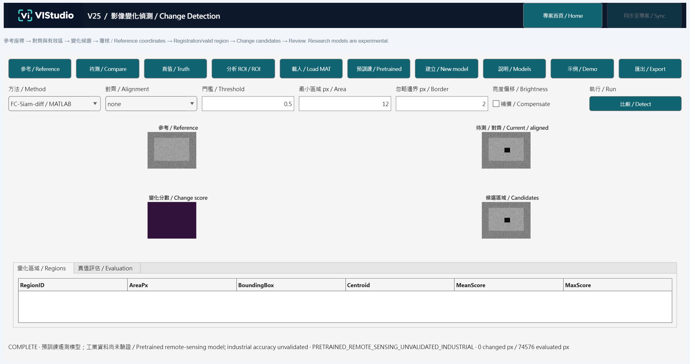

# FC-Siam 公開預訓練權重 / Public pretrained weights

V25 已附 **FC-Siam-diff** 與 **FC-Siam-conc** 的 MATLAB 原生預訓練 MAT，可以直接載入推論，不需要重新訓練、Python 或額外下載。

V25 bundles native MATLAB MAT checkpoints for **FC-Siam-diff** and **FC-Siam-conc**. Load them directly without retraining, Python or an additional download. Deep Learning Toolbox is required.



## 來源與授權 / Source and license

採用 [Open-CD 官方模型庫](https://huggingface.co/likyoo/Open-CD_Model_Zoo) 發布的 LEVIR-CD 權重，模型卡明確標示 **Apache-2.0**。本次依發布者提供的模型授權整理轉換檔，附帶完整授權文字、NOTICE、來源與原始／轉換後 SHA-256。這不會替整個 VIStudio 專案重新指定授權；訓練影像未隨包提供。

The source is the publisher's [Open-CD Model Zoo](https://huggingface.co/likyoo/Open-CD_Model_Zoo), whose model card declares **Apache-2.0**. Converted files include the publisher license text, attribution/modification notice, original URLs and original/converted SHA-256 hashes. This does not assign a new license to VIStudio as a whole. Training imagery is not bundled.

- Publisher revision: `6b88e874f8dea7430a2ab1ed84b356c6a67128a0`.
- Publisher files: `LEVIR-CD/fc_siam_diff_256x256_40k_levircd.pth` and `LEVIR-CD/fc_siam_conc_256x256_40k_levircd.pth`.
- Native files: `src/VIStudio_Pretrained_V23/fc-siam-diff-levircd.mat` and `fc-siam-conc-levircd.mat` in the source release; development uses the same folder at repository root.
- [Publisher model card](https://huggingface.co/likyoo/Open-CD_Model_Zoo) · [Open-CD configuration](https://github.com/likyoo/open-cd/blob/main/configs/_base_/models/fc_siam_diff.py) · [Parity results](../validation/fc-siam-pretrained-parity.json).

## 操作 / Use

1. 執行 `start_VIStudio` → 工作區第三頁 → 影像變化偵測。Launch Change Detection on workspace page three.
2. 先載入參考／待測 RGB 影像。Load reference and comparison images first.
3. 在模型選單選 FC-Siam-diff 或 FC-Siam-conc，再按 **預訓練 / Pretrained**。Select the variant and click **Pretrained**.
4. 按 Detect。預訓練按鈕會將門檻設為 0.5；ROI、最小面積等仍可調整。Run detection. The button sets threshold to 0.5; ROI and region filtering remain adjustable.
5. 檢視／覆核變化候選，需要時載入真值評估，再匯出。Review candidates, optionally evaluate against truth, then export.

**New model 建立的是隨機模型；Pretrained 才會載入隨附的已訓練權重。** 載入自己的原生 checkpoint 仍使用 Load MAT。任意 `.pth` 不會在工作區內自動執行或轉換。

**New model creates random weights; Pretrained loads the bundled trained weights.** Use Load MAT for another native checkpoint. Arbitrary `.pth` files are not executed or automatically converted in the workspace.

```matlab
addpath('src'); % source release
folder = fullfile(fileparts(which('VIStudioFCSiamV25')), 'VIStudio_Pretrained_V23');
file = fullfile(folder, 'fc-siam-diff-levircd.mat');
% Match the existing images without changing learned weights or resizing pixels.
model = VIStudioFCSiamV25.loadWeights(file, size(reference));
[score, probabilities] = VIStudioFCSiamV25.predict(model, reference, current);
% reference/current: same HxWx3 size, numeric RGB [0,1].
mask = score >= 0.5;
```

## 轉換與前處理 / Conversion and preprocessing

原始權重只在一次性轉換／對照階段使用 PyTorch 解開與建立參考輸出；日常載入與推論完全在 MATLAB。轉換保留共享編碼器、解碼器與 BN 的已學習值；將來源最後的線性 16 通道轉置卷積與線性 1×1 分類頭代數合併成原生雙類別輸出。沒有重新訓練，沒有以隨機權重代替預訓練參數。

PyTorch was used only for one-time tensor extraction and reference-output validation. Loading/inference run entirely in MATLAB. Encoder/decoder weights and BN state are preserved. The final linear 16-channel transposed convolution and linear 1×1 classifier are algebraically folded into a two-class native layer. No retraining or substitution with random weights occurred.

輸入為 RGB `[0,1]`，使用 mean `[0.485 0.456 0.406]`、std `[0.229 0.224 0.225]` 正規化，再於右／下補正規化後的零值到 32 倍數，最後裁回原尺寸。不是先補黑色 RGB 再正規化；不縮放影像，輸出座標保持原圖座標。模型已含前處理，呼叫端不要重複正規化。

RGB `[0,1]` is normalized by mean `[0.485 0.456 0.406]` and std `[0.229 0.224 0.225]`, zero-padded after normalization to multiples of 32, then cropped back to the original frame. Images are not resized. Pass raw RGB `[0,1]`; do not normalize a second time.

至少 16×16，補邊後最多 262144 像素。Pretrained 按鈕依已載入參考影像重建所需原生網路尺寸並套用同一組權重；不修改原始 checkpoint。未載入參考時採 256×256。大型影像需先準備適當視野，尚未提供自動大圖分塊。

Inputs must be at least 16×16 and fit the 262144-pixel limit after padding. Pretrained adapts native network geometry to the loaded reference while keeping the learned weights and original checkpoint unchanged; without a reference it uses 256×256. Automatic large-image tiling is not implemented.

## 本次驗證與限制 / Evidence and limits

兩種模型各比對五組自製合成影像，含 64×64、256×256、96×128、正常相同影像及 65×67 補邊案例。逐像素比較雙類別機率，驗收門檻為最大絕對差 `< 1e-5`，並核對 0.5 門檻遮罩。數值結果、環境、來源雜湊見 [parity evidence](../validation/fc-siam-pretrained-parity.json)。`run_validation` 可使用隨附的原創參考 fixtures，在不安裝 Python 的情況重跑 MATLAB 比對。

Each variant was compared on five original synthetic pairs, including square/non-square inputs, identical images and a 65×67 padded case. Checks compare both probability channels with maximum absolute error `< 1e-5` and masks at threshold 0.5. The native suite uses bundled original fixtures and runs without Python. See [parity evidence](../validation/fc-siam-pretrained-parity.json).

**這些是遙測建築變化權重，尚未驗證工業瑕疵準確率。** 數值轉換一致不等於工業影像上的檢出率；不同光照、反光、鏡頭、產品與缺陷類型仍需獨立測試。未驗證 GPU、所有硬體及 compiled standalone。範例庫仍維持暫緩；測試 fixtures 不是範例庫介面或下載服務。

**These weights detect remote-sensing building changes; industrial defect accuracy is unvalidated.** Conversion parity does not establish real inspection performance. GPU, all hardware platforms and compiled standalone deployment are untested. The example library remains deferred; test fixtures do not implement a library browser/downloader.
