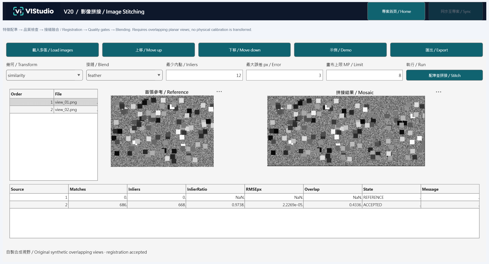

# 影像拼接 / Image Stitching

[README](../README.md) · [Future features](FUTURE_FEATURES.md)

工作區第三頁開啟 Image Stitching，或執行 `VIStudioStitchAppV20`。需要 Image Processing Toolbox 與 Computer Vision Toolbox；不需模型權重。

Open Image Stitching on page three or run `VIStudioStitchAppV20`. Requires Image Processing Toolbox and Computer Vision Toolbox, without model weights.

## 操作 / Workflow

1. 載入 2–20 張影像，依**相鄰重疊**順序排列。Move up/down 調整順序。 / Load 2–20 images in adjacent-overlap order; reorder with Move up/down.
2. 選擇 translation、similarity、affine 或 projective。初始為 similarity。 / Select a transformation; similarity is the default.
3. 設定最少內點、最大重投影誤差及畫布上限，選 feather 或 mean 融合。 / Configure inliers, reprojection error, canvas limit and feather/mean blending.
4. Stitch 後查看各張的匹配數、內點比例、RMSE、重疊比例與狀態。 / Review matches, inliers, RMSE, overlap and acceptance.
5. Export 每次建立新資料夾。失敗時也可匯出拒絕原因及品質表，但不產生成功拼接圖。 / Export into a new folder; rejected runs export diagnostics without a successful panorama.



## 演算法與品質 / Algorithm and gates

SURF 特徵與描述子匹配後，以 RANSAC 估計相鄰影像變換，累積到第一張參考影像。影像需具有足夠紋理及重疊。全平面、反光、重複花紋、明顯視差、移動物件及強烈曝光差異需要另行驗證。

SURF feature matching and robust estimation register adjacent views to the first reference image. Adequate texture/overlap are required. Blank surfaces, reflections, repetition, parallax, moving objects and exposure changes need separate evaluation.

預設最少 12 內點、25% 內點比例、3 px 最大重投影誤差與 5% 重疊門檻。這些是可調的接受規則，不是所有影像的精度保證。每對影像的 RMSE 也不代表全圖累積誤差已被校正。

Defaults require 12 inliers, 25% inlier ratio, 3 px maximum reprojection error and 5% overlap. These are gates, not universal accuracy guarantees. Pairwise RMSE does not establish globally corrected drift.

系統拒絕跨越影像的透視地平線、極端面積變形及過大畫布。總輸入上限 4000 萬像素；預設輸出上限 800 萬像素，可調至最多 3000 萬。流程沒有全域束調整、多頻帶融合或視差修正；這些保留後續評估。

Cross-image projective horizons, extreme area distortion and oversized canvases are rejected. Total inputs are limited to 40 million pixels; output defaults to 8 million and may be configured up to 30 million. Global bundle adjustment, multiband blending and parallax correction are not implemented.

## 輸出與座標 / Outputs and coordinates

```text
new-report/
  panorama.png
  valid-coverage.png
  contribution-count.tif
  registration-quality.csv
  stitch-report.mat
```

- Panorama 為歸一化灰階或 RGB，PNG 以 16-bit 儲存；不是 HDR／曝光融合。 / The normalized grayscale/RGB mosaic is saved as 16-bit PNG, not HDR fusion.
- Valid coverage 為有效像素；未覆蓋區為零，沒有生成式補圖。 / Coverage identifies real supported pixels; uncovered pixels are zero, without generative filling.
- Contribution count 記錄每個像素有幾張來源影像參與。 / Contribution count records the number of source images supporting each pixel.
- MAT 保留來源雜湊、全域變換、**輸出畫布像素變換**、世界座標範圍及品質資料。 / MAT retains source hashes, global transforms, canvas-pixel transforms, world limits and quality.

原圖不被覆寫。透明輸入須先明確攤平；目前不自行猜測透明背景。改變輸入或設定會清除舊結果；來源檔在運算前／中變更會阻擋成功輸出。

Originals are preserved. Flatten transparent inputs explicitly. Changing inputs/settings clears stale results; changed source files block a successful run.

**量測校正不自動轉移。** 拼接重取樣可能改變局部尺度；原始 mm/px 不能直接當成整張拼接圖的物理比例。需要精密量測時，先規劃校正與座標空間，或回到來源影像量測。

**Physical calibration does not transfer automatically.** Resampling can change local scale; original mm/px is not automatically a valid global mosaic scale.

## 參考 / References

- [Feature-based panoramic image stitching](https://www.mathworks.com/help/vision/ug/feature-based-panoramic-image-stitching.html)
- [estgeotform2d](https://www.mathworks.com/help/vision/ref/estgeotform2d.html)
