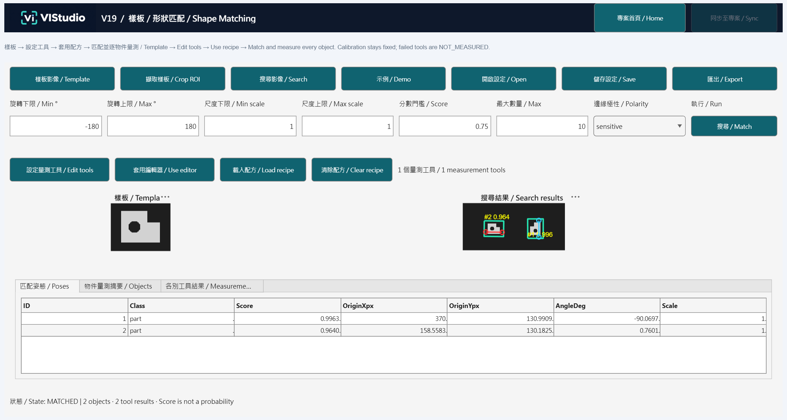

# 樣板定位與多物件量測 / Pose-aware Multi-object Measurement

[README](../README.md) · [Measurement](USER_GUIDE.md) · [Video ROI](VIDEO_EXTRACTION.md)

V20 在獨立樣板匹配工作區加入 Measurement 配方。每個匹配物件各自轉換工具座標，並在搜尋影像重新找邊或計算幾何，不複製樣板上的既有量測值。

V20 integrates Measurement recipes inside Shape Matching. Every match transforms its tool geometry and remeasures the search image, rather than copying a reference value.

## 操作 / Workflow

1. 載入樣板，必要時 Crop ROI；工具座標必須以這份裁切後影像為準。 / Load and optionally crop the template; tools belong to the exact cropped image.
2. 按 Edit tools 開啟 Measurement，放置工具、Capture 記錄，設定公差與 px/mm。 / Open Edit tools, place/capture tools and set tolerances and units.
3. 回匹配視窗按 Use editor；也可載入該樣板的 recipe MAT。參考影像尺寸與像素雜湊不符會拒絕。 / Click Use editor or load a recipe MAT; mismatched reference dimensions/hash are rejected.
4. 載入搜尋影像、設定旋轉／尺度／分數及最大物件數，按 Match。附加配方時自動逐物件量測。 / Configure the search and click Match; an attached recipe runs automatically for every match.
5. 查看 Poses、Objects、Measurements 三頁結果；畫布顯示每個物件的工具落點。 / Inspect pose, object-summary and per-tool tabs and the transformed tool overlays.
6. Export 匯出共同來源與疊圖，以及每個物件獨立的 CSV/MAT。Save/Open 會保存樣板、匹配設定與量測配方。 / Export shared inputs/overlays and per-object CSV/MAT; Save/Open persists the template, matching settings and recipe.



## 支援工具 / Supported tools

| 工具 / Tool | 行為 / Behavior |
|---|---|
| 卡尺 / Caliper | 轉換掃描線與寬度，再原生偵測邊對 / Transform the scan line/band and detect edge pairs again |
| 圓 / Circle | 轉換圓心與半徑；Snap 開啟時重新擬合 / Transform center/radius and refit when Snap is enabled |
| 角度 / Angle | 轉換三點；Snap 開啟時重新找線 / Transform three points and resnap lines when enabled |
| 距離 / Distance | 量測轉換後端點的幾何距離，不會自動找邊 / Measure transformed endpoints geometrically, without automatic edge detection |
| 點到線 / Point-to-line | 支援手動幾何；已捕捉的 snapped T-square 不可直接搬用 / Manual geometry supported; captured snapped T-squares cannot be replayed |

Mask 面積與旋轉長寬仍在獨立 Measurement 提供；本整合不直接扭轉樣板遮罩當成新物件真值。要加入這些量測，需先對搜尋物件重新分割。

Mask area/rotated dimensions remain available in standalone Measurement. This integration does not treat a warped template mask as newly segmented object truth.

## 校正與姿態 / Calibration and pose

正確的轉換以樣板模型原點為基準：

```matlab
relativePoints = templatePoints - model.ModelOrigin;
searchPoints = transformPointsForward(match.ModelOriginTransformation, relativePoints);
```

圓半徑與工具搜尋帶會依姿態尺度調整；**相機 mm/px 與公差保持不變**。尺度改變只用於工具幾何，不把舊量測值乘上尺度當作結果。支援未校正像素及固定 X/Y mm/px；內嵌鏡頭／透視校正配方暫不接受，避免混用座標空間。

Radius and tool search bands follow the pose scale; **camera mm/px and tolerances stay fixed**. Pose scaling changes tool geometry, never a saved measurement value. Pixel/fixed X-Y mm-per-pixel recipes are supported; embedded lens/perspective profiles are rejected until a shared rectified-space pipeline exists.

相似變換適用平面剛性零件；不代表三維深度補償。影像中的尺度、邊緣品質與遮擋仍需實測。分數是相似度而不是合格機率；最多匹配數也不是已知產品應有數量。

Similarity transforms target planar rigid parts, not 3-D depth compensation. Scale, edges and occlusion need validation. Similarity scores are not acceptance probabilities; MaxMatches is a result cap, not an expected-product-count check.

## 結果與失敗處理 / Results and failures

- ObjectID 是單次搜尋內的編號，不是跨影像追蹤 ID。 / Object IDs are local to one search, not persistent tracks.
- 工具超界、找不到邊或計算失敗：NaN + NOT_MEASURED，保留原因，其他工具與物件繼續。 / Invalid/out-of-bounds/missing-edge tools retain NaN and a reason; other tools and objects continue.
- 物件有未量得項目為 REVIEW；全部有效後才依公差顯示 OK／NG；未設公差為 MEASURED。 / Missing measurements produce REVIEW; valid results use tolerances for OK/NG, or MEASURED without limits.
- NO_MATCH 沒有虛構物件列；不會自動變成 NG，報告保留搜尋狀態。 / NO_MATCH produces no fabricated object rows and is not automatically NG.
- 更換樣板會解除配方；更換搜尋影像或有效設定會清除舊結果。 / Template changes detach recipes; image/settings changes clear stale results.

```text
new-report/
  matches.csv
  shape-report.mat
  shape-definition.mat
  measurement-recipe.mat
  object-summary.csv
  object-measurements.csv
  search-image.png
  all-object-measurements.png
  object_0001/measurements.csv
  object_0001/measurements.mat
  object_0002/...
```

MAT 保留各物件變換矩陣、實際量測紀錄與失敗定義；共同來源影像只保存於上層。沒有有效量測紀錄時不產生誤導性的成功疊圖。

Per-object MAT files retain transforms, records and failed definitions; the source is shared at the report root. A successful overlay is not fabricated when no valid records exist.

## 測試與限制 / Validation and limits

原生合成測試涵蓋兩個不同方向的物件、僅一個物件超差、1.2 倍尺度與固定 mm/px、找不到邊、超界失敗隔離、參考綁定、保存與匯出。多物件角度案例使用 ±2° 接受範圍，並以重新找邊確認尺寸；不宣稱所有影像的姿態精度。

Native synthetic cases cover two orientations, one altered part, 1.2x scale with fixed camera calibration, missing edges, bounds isolation, reference binding, persistence and export. The multi-object angle fixture uses a ±2° acceptance tolerance and remeasures edges; it is not a general pose-accuracy claim.

所有原生功能實測不等於實體量測精度認證、產線驗收或全部滑鼠操作已測試。詳見 [Validation](VALIDATION.md)。

Local native execution is not physical accuracy certification, production acceptance or exhaustive mouse/dialog validation.

本機 R2026b `26.2.0.3386108` 使用 UsePolarity，公開文件列出 EdgePolarity。介面在明確拒絕名稱時才切換參數，報告記錄 PolarityImplementation；不宣稱非敏感模式在不同 API 簽名下完全等價。

The local build exposes UsePolarity while public documentation lists EdgePolarity. Fallback occurs only on explicit argument rejection and is recorded in PolarityImplementation; insensitive behavior is not claimed identical across signatures.

## 官方參考 / References

- [shapemodel and pose-aware gauging](https://www.mathworks.com/help/visual-inspection/ref/shapemodel.html)
- [matchshape](https://www.mathworks.com/help/visual-inspection/ref/shapemodel.matchshape.html)


## V20 navigation / 工作區導航

Model tasks are on page one, annotation/metrology on page two, and video/stitching/synthesis on page three. The example library is deferred. See [feature analysis](FUTURE_FEATURES.md), [stitching](IMAGE_STITCHING.md) and [synthesis](DEFECT_SYNTHESIS.md).
