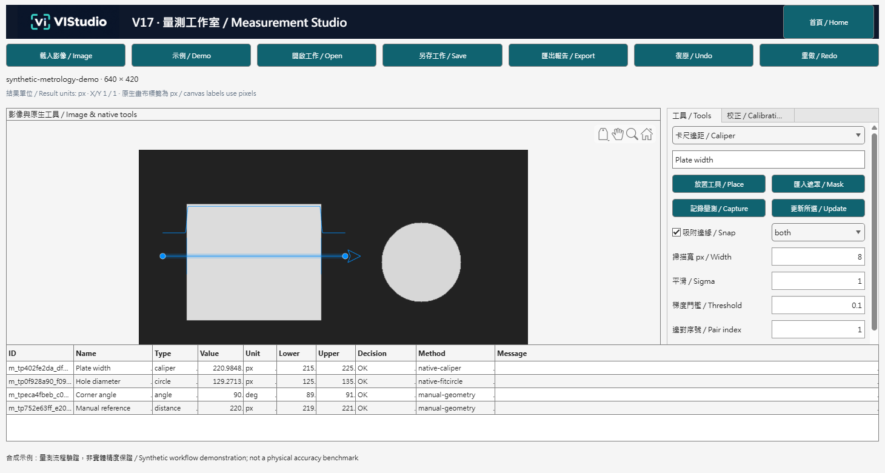
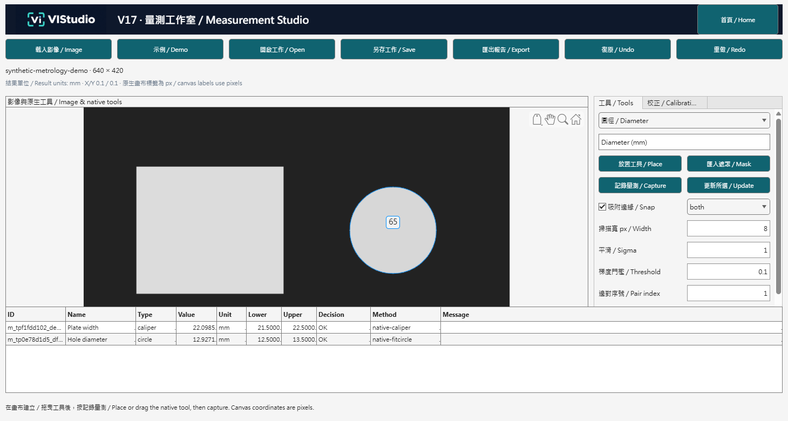
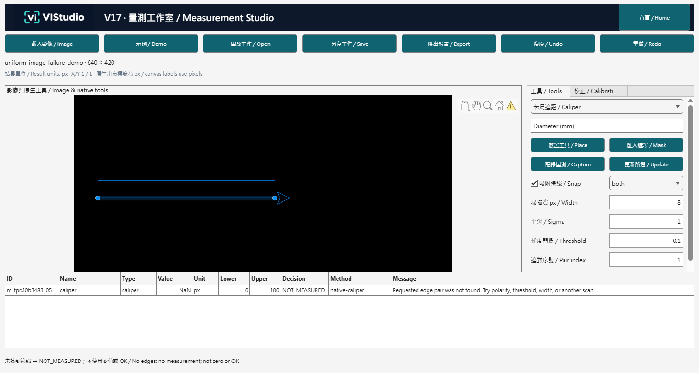

# 操作手冊 / User Guide

[首頁 / README](../README.md) · [English overview](../README.en.md)

## 1. 選擇入口 / Choose an entry

```matlab
start_VIStudio                   % V25 project hub
% Or, after adding src:
app = VIStudioMeasurementAppV25; % independent measurement
```

Measurement is independent of model training. It can be opened before creating a project. Existing classification/detection/anomaly/segmentation/keypoint workflows retain their versioned backends and project format.



## 2. 基本操作 / Basic operation

| 按鈕 / Control | 用途 / Purpose |
|---|---|
| Image | 載入灰階或 RGB 影像 / Load grayscale or RGB images |
| Demo | 載入程式生成的合成示例 / Load the generated synthetic fixture |
| Place | 在原生畫布放置所選工具 / Place a native tool in the viewer |
| Capture | 以目前位置與設定建立新紀錄 / Capture a new record |
| Update | 以目前工具更新所選紀錄 / Update the selected record |
| Limits | 修改所選紀錄的公差，不重做影像擬合 / Update tolerance without refitting |
| Undo / Redo | 還原或重做紀錄／校正變更 / Undo or redo record/calibration changes |
| Save / Open | 保存或開啟內嵌影像的量測工作 / Save/open an embedded-image session |
| Recipe / Apply | 另存或套用量測定義與校正 / Save/apply definitions and calibration |
| Batch | 對相同解析度與預期姿態的多張影像量測 / Process equal-resolution, consistently posed images |
| Export | 新資料夾匯出 CSV、MAT、影像、疊圖及工作階段 / Export artifacts to a new folder |

Changing images replaces the current measurement workspace. The UI asks before discarding unsaved work. Calling programmatic `loadImage` directly replaces data immediately; save first when using the API.

Supported images are grayscale/RGB `uint8`, `uint16`, logical, single or double. Floating input must be in `[0,1]`. Images must be at least 8×8. Indexed image files are converted through their colormap. Tool geometry is specified in the **current measurement image's pixel coordinates**, including after rectification.

## 3. 工具 / Measurement tools

| Type | Geometry | Result | Notes |
|---|---|---|---|
| `distance` | 2×2 endpoints | Endpoint distance | Manual geometry, not edge detection |
| `caliper` | 2×2 scan endpoints | Selected edge-pair width | Native `caliper`, adjustable polarity, threshold, width, sigma and pair index |
| `circle` | `[centerX centerY radius]` | Diameter | Native `fitcircle` when Snap is enabled; manual circle otherwise |
| `angle` | 3×2: start, vertex, end | Angle in degrees | Optional native `fitangle` edge snapping |
| `pointline` | 3×2: two line points, one measurement point | Perpendicular distance to the infinite reference line | Native `uitsquare` capture for snapping; manual geometry otherwise |
| `area` | H×W logical mask | Foreground pixel-cell area | Import a binary mask |
| `length` | H×W logical mask | Minimum rotated rectangle long side | Exactly one connected component |
| `width` | H×W logical mask | Minimum rotated rectangle short side | Exactly one connected component |

### Caliper / 卡尺

The scan direction determines edge polarity. `rising` finds dark-to-light starts, `falling` light-to-dark starts, and `both` accepts both. The native backend pairs opposite transitions. Pair index selects a particular pair in native scan order; review the profile and chosen geometry when several pairs exist.

The **Snap checkbox does not turn off caliper edge detection**. Caliper always uses the native detector. To measure endpoint separation instead, select Distance.

Width, Sigma, Threshold and Polarity are applied when placing the caliper. After changing them, place the tool again to apply the new settings. Pair index is read at capture. The result stores the settings actually used by the active caliper.

### Circle and angle / 圓與角度

Snap enabled requests native fitting. Fitted geometry is checked for supporting edges, and an unsupported result is not accepted as a successful measurement. Circle fitting uses a stored RANSAC seed and restores MATLAB's prior RNG state.

The application checks edge support to reject obvious no-edge cases; this is not a complete metrology uncertainty analysis. Check the fitted geometry before using tight tolerances.

### Mask / 遮罩

Choose Area, Length or Width, then Import mask. The mask must match the **current**, possibly rectified image size. Two-level masks require zero background. Zero means background and nonzero means foreground. Area counts pixel cells. Separate touching/disconnected objects before using a single-object rotated dimension.

## 4. 校正 / Calibration



1. Open Calibration.
2. Choose one method:
   - Apply X/Y **mm per pixel**.
   - Place a line spanning a known physical length and choose Reference line.
   - Load an existing geometry MAT containing `geometry` exported by the geometry workspace.
3. Capture measurements after calibration.

Calibration changes clear current records because units/coordinate frames may have changed. Undo restores the previous image frame, calibration and records. Lens-only correction retains pixel units until physical scale is supplied. Perspective calibration supplies its own X/Y scale; manual scale override is rejected until calibration is reset.

Distances, angles, point-to-line geometry, area and rotated dimensions account for separate X/Y scales. A physical **circle** requires isotropic scale. Measurements touching invalid rectified image regions are rejected. Source/calibration resolution mismatch is also rejected.

Native canvas annotations are in pixel coordinates. The table's Unit field is authoritative for captured results. Exported `measurement-image.png` and overlay use the current measurement image; the session embeds the original image and its calibration.

**A subpixel fitted value is not a guarantee of physical accuracy.** Validate optics, lighting, calibration, material and repeatability against known physical artifacts before defining production tolerances.

## 5. 公差與失敗 / Tolerances and failures

Blank lower/upper limits mean unrestricted on that side. Both blank means a measurement only. Inclusive bounds give OK; values outside give NG. Failed measurements use NaN and NOT_MEASURED, never zero-as-success.



Common failures: no requested edge pair, insufficient circle/line edge support, degenerate geometry, anisotropic physical circle scale, unsupported snapped point-to-line replay, or resolution/calibration mismatch. Read Message for the specific reason. Correct the setup and update the measurement.

## 6. 保存與資料格式 / Persistence

All save/export paths must be new. The app rejects overwriting an existing file or report directory.

| Artifact | Stored contents |
|---|---|
| Session MAT (`session`) | Embedded original image, source hash/name, recipe, record IDs and records; loading recomputes results |
| Recipe MAT (`recipe`) | Source resolution, calibration, scale/unit, geometry, settings and tolerances; no raw image |
| `measurements.csv` | Name/type/value/unit/limits/decision/method/message plus ID |
| `measurements.mat` | Table, detailed native outputs, definitions, calibration and source hashes |
| `measurement-overlay.png` | Captured geometries and recorded values, in current-image coordinates |
| `batch-summary.csv` | Per-image state, measurement count, NG count, failed-measurement count and error |

The source hash checks embedded image integrity; it does not authenticate who captured an image. The session recomputes results to prevent edited saved values from becoming authoritative. Record IDs must be unique and nonempty.

## 7. 程式範例 / API examples

```matlab
addpath('src')
[image, definitions, mask] = VIStudioMeasurementDemoV17;
d = VIStudioMeasurementV17;
d.loadImage(image, 'synthetic-fixture');
d.setScale(0.1, 0.1);                 % mm per pixel, clears records
d.add('distance', [80 320; 300 320], ...
    struct('Name', "Reference", 'Lower', 21.9, 'Upper', 22.1));
d.add('caliper', [40 175; 340 175], ...
    struct('Name', "Plate width", 'Width', 8, ...
           'Threshold', 0.08, 'Lower', 21.5, 'Upper', 22.5));
d.add('circle', [465 185 62], struct('Name', "Diameter", 'Snap', true));
d.add('area', mask, struct('Name', "Plate area"));
disp(d.table())

output = tempname;                   % new report directory
d.export(output)
```

Reusable recipe and batch:

```matlab
recipeFile = [tempname '.mat'];
d.saveRecipe(recipeFile)

next = VIStudioMeasurementV17;
next.loadImage('another-equal-resolution-image.png');
next.applyRecipe(recipeFile)

files = ["image1.png"; "image2.png"];
batchFolder = tempname;
summary = VIStudioMeasurementV17.batch(recipeFile, files, batchFolder);
```

Fixed geometry assumes consistent part pose; automatic registration/change detection is not part of V25. **A snapped point-to-line capture is tied to its captured source hash.** Replay on a different image is rejected; recapture interactively or use an unsnapped fixed point-to-line recipe.

## 8. Troubleshooting / 排除問題

| Symptom | Action |
|---|---|
| Missing `viewer2d`, `uicaliper` or `fitcircle` | Check MATLAB R2026b and the relevant toolbox installation/license |
| NOT_MEASURED on caliper | Check scan direction, polarity, profile, threshold, width and pair index |
| Several nearby edges | Restrict the scan and select the intended pair; do not assume the first is always correct |
| Wrong mm value | Confirm mm/px direction, known length, calibration plane and image resolution |
| Circle rejected in mm | Use isotropic scale or a properly rectified plane |
| Batch dimension errors | Use equal-resolution, consistently posed images or prepare another recipe |
| Unexpected source path resolution | Add `src` only; avoid adding legacy `source/`, backups or tests using genpath |
| COCO Python bridge unavailable | Configure a supported Python environment with numpy/pycocotools; unrelated to measurement |
| Workspace says V16 | Existing vision pages retain their versioned backend/UI labels; the V25 launcher and measurement tool are the new release |

For defects, include MATLAB release, toolbox list, exact steps, error text and a minimal shareable fixture. Do not include private datasets or model weights in issue attachments.


### 開發原稿與發布版 / Development and release layouts

開發原稿的 `.m` 檔位於根目錄；發布包放在 `src/`。兩者皆使用 `start_VIStudio` 啟動。V25 新增版本化介面，舊版實作與資料格式保持相容；README 與圖片已從發布版同步回開發原稿。

Development `.m` files are in the repository root; the source release uses `src/`. Both launch through `start_VIStudio`. V25 adds current versioned frontends while retaining legacy implementations and compatible data schemas. The release README and images have been synchronized back to the development source.


## V25 integrated workflows / 整合流程

[Pose-aware multi-object measurement / 定位後多物件量測](SHAPE_MATCHING.md) · [Video ROI extraction / 影片擷取](VIDEO_EXTRACTION.md) · [Example-library assessment / 範例庫評估](EXAMPLE_LIBRARY_ASSESSMENT.md).

Create measurement tools on the exact cropped template and attach that recipe inside Shape Matching. Video extraction is a separate workspace on page two; it uses a fixed ROI, not tracking. The example library is evaluated only.


## V25 navigation / 工作區導航

Model tasks are on page one, annotation/metrology on page two, and video/stitching/synthesis on page three. The example library is deferred. See [feature analysis](FUTURE_FEATURES.md), [stitching](IMAGE_STITCHING.md) and [synthesis](DEFECT_SYNTHESIS.md).
