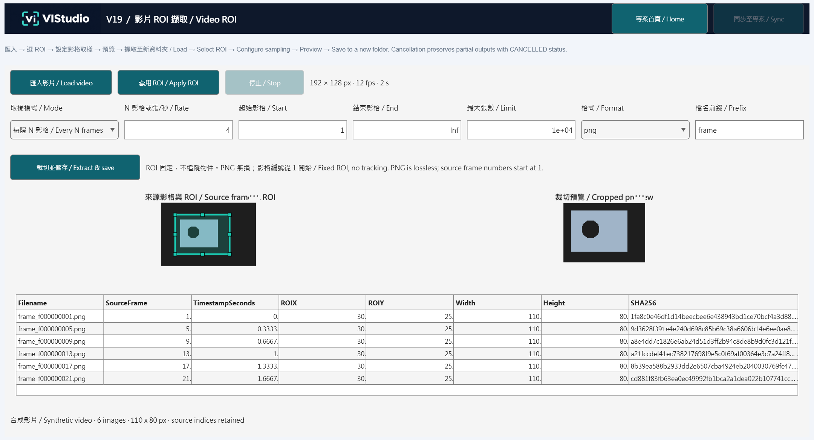

# 影片 ROI 擷取 / Video ROI Extraction

[README](../README.md) · [Vision workflows](VISION_WORKFLOWS.md)

從首頁工作區第三頁選「影片 ROI 擷取」，或執行 `VIStudioVideoExtractAppV25`。以串流方式逐影格解碼，不一次把整段影片讀進記憶體。

Open Video ROI on workspace page three or run `VIStudioVideoExtractAppV25`. Extraction decodes frames sequentially without keeping the entire video in memory.

## 操作 / Workflow

1. **匯入影片 / Load video**：由 `VideoReader` 讀取第一個可解碼影格，顯示尺寸、平均 FPS 與長度。支援格式及編碼依 MATLAB 與作業系統解碼器而定。 / Preview the first decoded frame and inspect dimensions, average FPS and duration. Codec support depends on MATLAB and the operating system.
2. **選定 ROI / Choose ROI**：拖曳、縮放左側矩形，再按 Apply ROI；右側顯示實際裁切預覽。ROI 是固定影像座標，不追蹤移動物件。 / Move/resize the rectangle and click Apply ROI. The right pane previews the exact crop. The ROI is fixed in image coordinates and does not track objects.
3. **設定取樣 / Configure sampling**：選擇「每隔 N 影格」或「每秒 N 張」。 / Choose every N frames or images per second.
4. **起訖與數量 / Bounds and limit**：起始影格從 1 開始；End=`Inf` 代表到結尾；最大張數預設 10000，可自行調整。 / Frame indices start at 1; `Inf` means end of video; the image limit defaults to 10000.
5. **格式 / Format**：PNG 無損，適合標記與量測；JPG 為有損壓縮。 / PNG is lossless and preferable for annotation/measurement; JPG is lossy.
6. **擷取 / Extract**：選父資料夾，每次建立新的輸出子資料夾，保留舊有輸出。Stop 會在影格處理間停止，保留已存影像及部分清單。 / Select a parent folder. Each run creates a new subfolder. Stop takes effect between decoded frames and preserves partial output.



## 取樣規則 / Sampling semantics

| 模式 / Mode | 規則 / Rule | 例子 / Example |
|---|---|---|
| 每隔 N 影格 / Every N frames | 從 StartFrame 開始，每增加 N 個解碼影格儲存一次 / Start at StartFrame and save each Nth decoded frame | Start=2、N=3、End=11 → **2, 5, 8, 11** |
| 每秒 N 張 / Images per second | 從起始影格時間開始，在每個目標時間選第一個到達該時間的解碼影格 / At each target time, select the first decoded frame reaching it | 12 fps、N=3 → 約 **1, 5, 9** / approximately 1, 5, 9 |

每秒張數不可高於來源平均 FPS。變動幀率影片以解碼器回報的時間選取，不以 `影格編號 / 平均 FPS` 假裝成精確時間。時間欄位取自讀取前的 `VideoReader.CurrentTime`；它不是經認證的原始攝影機時間戳。

Requested images/second must not exceed average source FPS. Variable-frame-rate selection uses decoder-reported time rather than pretending that index / average FPS is exact. Timestamps use `VideoReader.CurrentTime` before `readFrame`; they are not certified original capture timestamps.

ROI 使用一基底整數像素 `[x y width height]`，輸出剛好 `height × width`。超出影像或非正尺寸會阻擋執行，不會偷偷截斷 ROI。影格編號代表逐次解碼序號，並不依賴可能不準確的 `NumFrames`。

ROIs use one-based integer pixels `[x y width height]`, producing exactly `height × width` pixels. Invalid/out-of-frame ROIs block extraction rather than being silently clipped. SourceFrame records the sequential decoded index, independent of potentially inaccurate NumFrames metadata.

## 輸出與狀態 / Outputs and status

```text
new-run-folder/
  frame_f000000002.png
  frame_f000000005.png
  frames.csv
  extraction.json
  extraction.mat
```

- `frames.csv`：檔名、來源影格、秒數、ROI、輸出尺寸及影像 SHA-256。 / Filenames, source indices, time, ROI, output size and image SHA-256.
- JSON/MAT：來源影片雜湊、設定、來源資訊、實際解碼／輸出數量及停止原因。JSON 的 EndFrame 若為 null，配合 `EndFrameIsEOF=true` 表示到片尾。 / Source hash, options, metadata, decoded/saved counts and stop reason. JSON EndFrame=null with EndFrameIsEOF=true means EOF.
- `COMPLETE`：完成設定範圍或張數上限；查看 StopReason 的 EOF／END_FRAME／MAX_IMAGES。 / Completed the configured range/limit; inspect StopReason.
- `CANCELLED`：人工停止，部分輸出保留。 / User stopped; partial output retained.
- `NO_FRAMES`：起始影格超出實際解碼影片。 / Start is beyond the decoded video.
- `ERROR`：解碼、寫檔、來源變更或其他錯誤；已輸出檔案保留供檢查。 / Decode, write, source-change or other failure; outputs remain for review where storage permits metadata writing.

同一設定重跑會建立新資料夾；影片載入後若內容改變，須重新載入。輸出清單及影格通常包含使用者自己的資料，分享時請自行選擇可公開內容。

Reruns create new folders. Reload the source if its content changes after import. Exported frames/manifests contain the user's own data; choose shareable material when reporting issues.

## 本版界線 / Scope

目前為單一固定矩形 ROI，沒有物件追蹤、多 ROI、音訊處理、影片重新編碼或自動建立 train/test 切分。長影片仍須順序解碼到指定範圍，速度取決於編碼器、解析度與磁碟。若同一影片抽出的近似影像直接隨機切分，容易造成資料洩漏；訓練資料宜依來源影片或時間段分組。

This version supports one fixed rectangular ROI, without tracking, multiple ROIs, audio, re-encoding or automatic train/test splits. Sequential decoding cost depends on codec, resolution and storage. Split extracted training data by source video or time group to avoid leakage from near-duplicate frames.

## 官方參考 / References

- [VideoReader](https://www.mathworks.com/help/matlab/ref/videoreader.html)
- [readFrame](https://www.mathworks.com/help/matlab/ref/videoreader.readframe.html)
- [hasFrame](https://www.mathworks.com/help/matlab/ref/videoreader.hasframe.html)


## V25 navigation / 工作區導航

Model tasks are on page one, annotation/metrology on page two, and video/stitching/synthesis on page three. The example library is deferred. See [feature analysis](FUTURE_FEATURES.md), [stitching](IMAGE_STITCHING.md) and [synthesis](DEFECT_SYNTHESIS.md).
