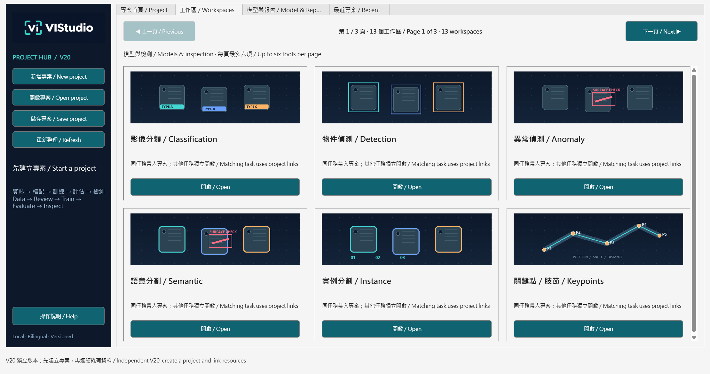

# 既有視覺工作流程 / Existing Vision Workflows

[README](../README.md) · [Measurement guide](USER_GUIDE.md)

V20 adds paged workspaces and native shape matching while retaining the established vision workspaces. These pages intentionally use their stable versioned implementations. Their presence does not mean every model/support-package combination has been executed in this release.



## Project organization / 專案組織

1. Create a project and choose classification, detection, anomaly, semantic, instance or keypoints.
2. Link an image folder, annotation session, exported dataset, saved model or evaluation MAT.
3. Use Data → Label → Train → Evaluate → Inspect to open the relevant workspace.
4. Use Sync to save new artifacts and update project links; refresh the homepage afterward.

The project file stores links and metadata. It is not a self-contained dataset archive. Links inside the project folder can be relative; external resources still need relocation after moving them. A linked model is not evidence of a completed training run, and an attached report is not automatic acceptance.

Measurement is an independent tool in this release. Its session/recipe files are saved separately; they are not automatically added to the five-stage project schema.

## Classification / 影像分類

Organize images in class subfolders:

```text
classification-data/
  class_a/
  class_b/
```

Open Classification → Training, load the folder, inspect the distribution/images, choose a model and configure training/data roles. Pretrained architectures may need a separately installed support package or a weight download. A model dropdown selection does not load or validate weights by itself.

Keep independent validation/test data. Save the trained model using the workspace's model export and load it in Inspection. The model's class order must remain consistent with its metadata. The model visualization page provides the existing architecture/explanation entry points when supported.

## Object detection / 物件偵測

Use the annotation studio or load compatible `exportROI`/`gTruth` MAT annotations. Detection tables resolve images and class-specific rectangles; invalid/missing images and out-of-bounds geometry must be corrected first.

Open the detector Training page, load the annotation MAT, configure model and data splits, then train with the required resources. Inspection returns boxes/classes/scores. Evaluate against independent ground truth; do not treat an unlabeled image as a confirmed negative merely because no annotation file was provided.

## Anomaly detection / 異常偵測

Keep training, threshold calibration and held-out testing as separate sources. Normal-only methods and methods that require anomaly examples have different data requirements; follow the selected model's interface. FCDD workflows require normal/anomalous examples, and mask-supervised paths require their corresponding truth masks.

Choose the normal label and calibrate thresholds with separate calibration data when required. Threshold calibration is not held-out test performance. Evaluate on an independent test set before using the inspection decision. Student/teacher and other deep-model paths depend on their corresponding resources; this release does not certify every path.

## Semantic segmentation / 語意分割

Use the semantic label mode and export a dataset containing images, per-pixel class masks and the class table. Keep class IDs consistent; reserved ignore labels are excluded by the relevant existing training/evaluation path.

Load the exported dataset in Semantic, assign train/validation/test roles, choose an available model and configure resizing/tiles, augmentation and class weighting. Existing evaluation includes per-class segmentation metrics; do not interpret image-level classification accuracy as pixel-level IoU/Dice.

## Instance segmentation / 實例分割

Each object has an independent mask and instance identity, including overlapping objects. Use split/merge and review all model candidates before marking an image reviewed. Export an instance dataset, then load it in the instance workspace.

Native model adapters include Mask R-CNN and SOLOv2 where installed/supported. The detailed evaluation view includes confidence-ranked mask AP across IoU thresholds, per-class results, size ranges, recall and PR plots. Official COCO evaluation is optional and requires the configured Python bridge. Crowd/ignore instance truth is not supported by the editable ordinary-instance export path.

## Keypoints / 關鍵點與肢節

Select an industrial, human or custom point template and keep names/order consistent. Visibility is 0 unknown, 1 occluded with a coordinate, or 2 visible. Unknown points use NaN internally. Review and export a keypoint dataset.

The existing HRNet adapter uses supplied object boxes. The current native training adapter requires fully visible points; missing/occluded annotations remain available for review/evaluation. Its PCK evaluation is conditional on object boxes, not end-to-end object-plus-pose detection or OKS AP. Missing predicted points remain in the evaluated truth-point denominator.

## Annotation and quality / 標記與品質

The studio supports instance/region and point editing, review gates, undo/redo, recovery, SAM prompts where available, quality findings and reviewer comparisons. AI candidates require human acceptance/correction/rejection before reviewed export. Quality findings are review prompts and do not automatically delete truth.

COCO exchange supports class mapping preview, independent RLE masks and point visibility. Polygon conversion and official evaluation use the optional pycocotools bridge. Original image dimensions, mask dimensions, template consistency and safe image paths must match.

## Advanced workbench / 進階工具

The existing advanced workspace includes model comparison, image-quality checks, reviewed hard-sample queues, geometry/lens calibration, rotated dimensions and product recipes. The independent measurement studio can load an existing geometry MAT containing `geometry`; its measurement results remain a separate workflow in V17.

## Models and reproducibility / 模型與追溯

Models are not included in the repository. Use the export/load actions for the corresponding task; many paths require a MAT variable named `model` plus task-specific metadata. A MAT containing arbitrary numeric data is not a usable detector merely because its variable is named `model`.

Retain dataset roles, source identities, class/template order, preprocessing, calibration and threshold settings with the model/report. Existing source-hash/provenance checks do not replace a review of the complete dataset and training protocol.

## Scope / 本版界線

The packaged regressions verify data, annotation/project integration and UI construction. They do not establish the accuracy or runtime compatibility of every large model, GPU configuration or external MAT format. Use the model-free Measurement Demo to check the new independent workflow without pretrained weights.


## Shape Matching / 樣板匹配

The independent R2026b Shape Matching workspace is on workspace page two. It supports template load/crop, rotation/scale search, score controls, pose tables, definition save/load and CSV/MAT export. V20 supports template-bound tool alignment and per-object remeasurement. It does not extend the five-stage model-project schema. See [assessment and guide](SHAPE_MATCHING.md).


## V20 integrated workflows / 整合流程

[Pose-aware multi-object measurement / 定位後多物件量測](SHAPE_MATCHING.md) · [Video ROI extraction / 影片擷取](VIDEO_EXTRACTION.md) · [Example-library assessment / 範例庫評估](EXAMPLE_LIBRARY_ASSESSMENT.md).

Create measurement tools on the exact cropped template and attach that recipe inside Shape Matching. Video extraction is a separate workspace on page two; it uses a fixed ROI, not tracking. The example library is evaluated only.


## V20 navigation / 工作區導航

Model tasks are on page one, annotation/metrology on page two, and video/stitching/synthesis on page three. The example library is deferred. See [feature analysis](FUTURE_FEATURES.md), [stitching](IMAGE_STITCHING.md) and [synthesis](DEFECT_SYNTHESIS.md).
